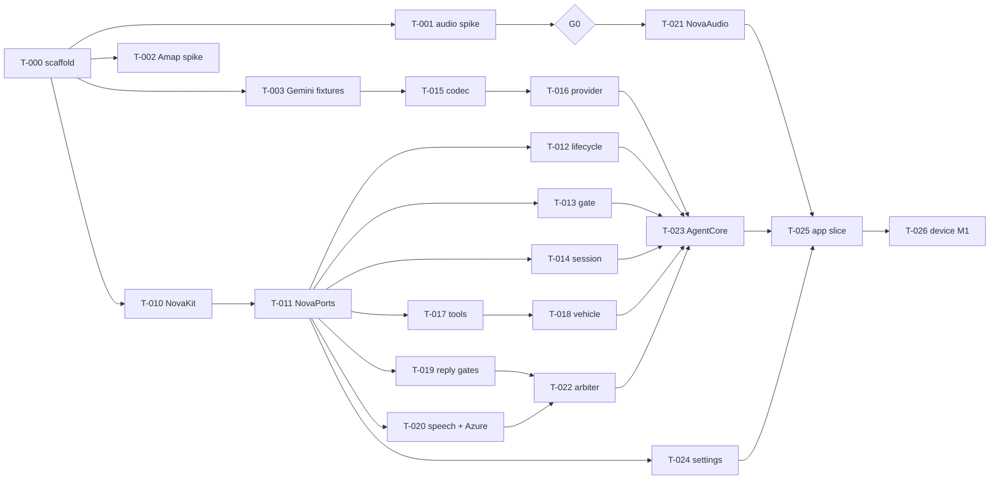

# iOS implementation plan (v1, 2026-10-23)

This breaks [migration-plan.md](migration-plan.md) milestones M0–M7 into task packets that follow the
[ios-architecture.md](ios-architecture.md) structure. Each row is one Executor task in the format of
[ai-agent-workflow.md](ai-agent-workflow.md). The defaults are: at most 3 attempts, 40 minutes, and
the reviewer verdicts PASS / REWORK / BLOCKED / NOT_VERIFIED. Paths are relative to the iOS repo
(`NovaDriveIOS/`). `Core/` is short for `Packages/NovaCore/Sources/`.

## 1. Before any code: prerequisites

| Need | For | Who | Status |
|---|---|---|---|
| A Mac with Xcode (Swift 6) and a physical iPhone; an Apple developer account | all; device rows | OWNER | needed by T-000 |
| Minimum iOS version (iOS 18 proposed) | T-000 | OWNER (OQ-IOS-12) | DECIDED: iOS 18.0 |
| Gemini API key + consent, Azure Speech key + voice | M1 | OWNER | needed by T-003 |
| Amap iOS SDK key (bound to the bundle id) + Amap Web key | M0 spike, M3 | OWNER | needed by T-002 |
| iFlytek iOS SDK downloaded for the same app id | M5 | OWNER (OQ-IOS-1) | needed by T-060 |
| Background SLEEP policy | M5 | OWNER (OQ-IOS-13) | needed by T-062 |
| Apple Music only for named music? | M6 | OWNER (OQ-IOS-7) | DECIDED 2026-10-27: no named music; T-072 not applicable |
| CarPlay category | M7 | OWNER (OQ-IOS-8) | DECIDED 2026-10-27: skip CarPlay; T-080 not applicable |
| Ephemeral-token backend | release | OWNER (OQ-IOS-15) | not blocking |

The Android test tables (guards, context resolver, vehicle golden files, uplink-gate PCM corpus,
navigation choice tables) come in through EVIDENCE_REQUEST. Ask for them in batches at the start of
each milestone so Executors are not blocked mid-task.

## 2. Gates used below

`build` (swift build / xcodebuild), `unit` (swift test), `contract` (fixture replay), `lint`
(swiftlint --strict), `secrets`, `imports` (ios-architecture §3.2), and `spec-trace` (every
acceptance ID has a test). **S** = simulator test, **D** = device evidence required. A D row stays
NOT_VERIFIED until a device run is attached.

## 3. Milestones and tasks

### M0: scaffold and spikes

| ID | Task | Depends | Owned paths | Acceptance / output | Gates |
|---|---|---|---|---|---|
| T-000 | Repo scaffold: package layout and NovaCore targets (empty), adapter packages, App project, `AGENTS.md`, gate scripts (`imports`, `secrets`, `spec-trace`), CI (macOS: swift test + xcodebuild) | prerequisites | whole tree, `scripts/`, CI config | All gates run green on an empty tree; a planted `import UIKit` in NovaCore fails `imports` | build, unit, lint, secrets, imports |
| T-001 | Audio spike app: VP engine, loud 24 kHz playback, 10 silent trials; three AGC configurations; sink node vs tap latency | T-000 | `Spikes/AudioSpike/` | Answers OQ-IOS-3 and OQ-IOS-14 in open-questions.md, with clips and numbers | D |
| T-002 | Amap hello-route: key from the Keychain at runtime, privacy-compliance calls, multi-route, route-select call, `startEmulatorNavi`, `playNaviSoundString` log | T-000 | `Spikes/AmapSpike/` | Closes the remaining part of OQ-IOS-2; records Amap callback threads | S, D |
| T-003 | Gemini recorder: `URLSessionWebSocketTask` setup + audio + tool call against the live API; save sanitised server messages | T-000 | `Spikes/GeminiRecorder/`, `Packages/NovaRealtime/Tests/fixtures/gemini/` | ≥6 `.jsonl` fixtures: plain turn, tool turn, interrupted, goAway, resumption, 1007 close; no keys or transcripts of real people | secrets |
| **G0** | **Decision gate**: is voice processing good enough (≥9/10 silent trials without the gate opening)? If not, plan AEC3 in NovaAudio (ios-architecture §6.7) | T-001 | — | Written go/no-go per subsystem | OWNER review |

### M1: vertical slice, "talk to 小诺 and turn on the AC, truthfully"

| ID | Task | Feature | Depends | Owned paths | Acceptance | Gates |
|---|---|---|---|---|---|---|
| T-010 | NovaKit: `NovaInstant`, `Clock`/`ManualClock`, `Epoch`, `Generation`, `TurnID`, `CallID`, `JSONValue`, `ToolResult` + codes, `DiagnosticEvent` (no String payloads), `*Tuning` | — | T-000 | `Core/NovaKit/` | Types distinct; `DiagnosticEvent` has no String payloads (test) | build, unit |
| T-011 | NovaPorts: the protocols and `RealtimeEvent` from ios-architecture §4 | — | T-010 | `Core/NovaPorts/` | Compiles under Swift 6 strict concurrency; every type `Sendable` | build |
| T-012 | Listening lifecycle + local intents | F-02 | T-011 | `Core/NovaVoice/Lifecycle/` | F-02 §10 (4 rows) | unit, spec-trace |
| T-013 | Mic gain, 10 ms framer, uplink gate (PCM corpus) | F-03 (logic), F-04 | T-011 | `Core/NovaVoice/Uplink/` | F-04 §10 (3 rows); F-03 frame-size row | unit, spec-trace |
| T-013a | `SpeechClassifier` port + `SpeechConfirmation` gate rule (confirming state, fallback, 抗噪 switch) | F-04a | T-013 | `Core/NovaVoice/Uplink/`, `Core/NovaPorts/` | F-04a §10 rows 5–6 | unit |
| T-013b | `SoundAnalysisSpeechClassifier` (SNAudioStreamAnalyzer); voice processing pinned | F-04a | T-013a | `Packages/NovaAudio/` | F-04a §10 rows 4, 8 | build, D |
| T-013c | Barge-in uses speech confirmation; 音频测试 diagnostics line; 设置 抗噪 switch | F-04a | T-013a | `Core/NovaVoice/Arbiter/`, `App/NovaDrive/` | F-04a §10 rows 3, 7 | unit, S, D |
| T-013d | Noise corpus fixtures + corpus tests | F-04a | T-013a | `Fixtures/audio/noise/`, tests | F-04a §10 rows 1–2 | unit |
| T-014 | `VoiceSession` state machine + `ReconnectPolicy` | F-05 core, F-24 | T-011 | `Core/NovaVoice/Session/` | contracts/voice-agent.md §1 and §8 transitions; auth error → no retry | unit |
| T-015 | Gemini codec, turn assembler, error classifier | F-05 | T-011, T-003 | `Packages/NovaRealtime/Sources/Codec/` | Fixture replay gives the §4 event order; 1007/1008 classification | unit, contract |
| T-016 | Gemini transport + provider; local fake WebSocket server | F-05, F-24 | T-015 | `Packages/NovaRealtime/` | F-05 §10 rows 2–3; F-24 §10 row 1 (W4) | unit, contract |
| T-016g | Callbacks answered once: `ResumeOnce` helper, ping double-callback crash fix, audit of Apple-callback continuations | F-05, F-24 | T-016 | `Packages/NovaRealtime/`, `Packages/NovaPlatform/`, `Packages/NovaAudio/` | F-05 §14 rows 1–8 | unit, review, D |
| T-016h | Wait for the network: `NetworkPathWatcher`, offline wait without spending attempts, immediate reconnect on restore, 10 min offline cap | F-24 | T-016g | `Packages/NovaPlatform/`, `Packages/NovaCore/`, `App/NovaDrive/` | F-24 §14 rows 1–10 | unit, build, D |
| T-016a | `LocalTranscriber` port, `TranscriptSelector`, `TranscriptLanguage`, `wordsReliable` | F-05a | T-016, T-013a | `Core/NovaPorts/`, `Core/NovaVoice/Transcript/`, `Core/NovaTools/Dispatch/` | F-05a §10 rows 1–4 | unit |
| T-016b | `AppleSpeechTranscriber` (on-device zh-CN), import gate, Info.plist key | F-05a | T-016a | `Packages/NovaAudio/`, `scripts/gates/` | F-05a §4 | build |
| T-016c | Transcriber wiring in `AgentRuntime`, 音频测试 diagnostics line | F-05a | T-016b | `App/NovaDrive/` | F-05a §10 rows 5–9 | S, D |
| T-016d | Transcript display-only: no tool guard reads it; withdraw `wordsReliable` / `wordsUnclear` | F-05a | T-016a | `Core/NovaTools/Dispatch/`, `Core/NovaAgent/` | F-05a §10 row 4 (revised) | unit |
| T-016e | 结束导航 ends at once: remove the exit confirmation (`CONFIRM_REQUIRED`) | F-05a | T-016d | `Core/NovaTools/Dispatch/` | F-05a §6 (ending navigation) | unit, D |
| T-016f | Bundled sherpa-onnx streaming Mandarin recognizer replaces Apple's (no keyboard dependence, no speech permission) | F-05a | T-016c | `Packages/NovaAsrSherpa/`, `App/NovaDrive/`, `scripts/`, `codemagic.yaml` | F-05a §12 rows 1–10 | unit, gate, build, D |
| T-022a | Stop phrase while she talks: sherpa keyword spotter on a fixed 7-phrase set, transcript as backup | F-08 | T-016f | `Packages/NovaAsrSherpa/`, `Core/NovaVoice/`, `App/NovaDrive/` | F-08 §14 rows 1–8 | unit, build, D |
| T-022b | Stop phrase also ends the reply for Gemini: START_OF_ACTIVITY_INTERRUPTS + empty activity on a stop, unmute on stop, re-ask names the newest question, scoped abandonNextTurn | F-08, F-06, F-05 | T-022a | `Packages/NovaCore/`, `Packages/NovaRealtime/`, `App/NovaDrive/` | F-08 §15 rows 1–9 | unit, S, D |
| T-022c | After 别说了 nothing is sent until real words: stop utterance held to the pause, 3 s post-stop window with word-gated release (local ASR) or drop, no reply without a sent utterance | F-08, F-04, F-05a | T-022b | `Packages/NovaCore/`, `App/NovaDrive/` | F-08 §16 rows 1–12 | unit, build, D |
| T-017 | Tool catalog (Android names and schemas byte-for-byte), validation, guards in order, dispatcher decisions, `ToolFailureAdvice`, `NotYetExecutor` | F-09 | T-011 + Android tables | `Core/NovaTools/Dispatch/` | F-09 §10: every guard table ported; sunroof → `UNSUPPORTED_BODY_PART` | unit, spec-trace |
| T-018 | Climate/seat/window handlers + `SimulatedVehicle` with fault injection | F-11 | T-017 | `Core/NovaTools/Vehicle/`, `Packages/NovaServices/Sources/Vehicle/` | F-11 §10 golden files; `BACKEND_LABEL=simulated` | unit |
| T-019 | Reply pipeline: claim gate, `ActionClaimGuard`, correction grace, empty-response re-ask, phantom gate | F-06 | T-011 | `Core/NovaVoice/Reply/` | F-06 §10 (3 rows); W3 | unit, spec-trace |
| T-020 | Clause segmenter, wait cues, revoicer queue (≤2 in flight, ordered, epoch drop); Azure REST client | F-07 | T-011 | `Core/NovaVoice/Speech/`, `Packages/NovaServices/Sources/Azure/` | F-07 §10 rows 2–3 with fakes; deadline 4000 + 400 ms × chars | unit, contract |
| T-021 | NovaAudio: session policy, VP engine, capture chain (ring, converter, framer hookup), reply lane with epoch flush, session monitor | F-03, F-07 | T-011, G0 | `Packages/NovaAudio/` | Flush drops scheduled buffers (S); F-03 §10 rows 1–2 (D) | build, S, D |
| T-022 | Minimal arbiter: barge-in qualification, flush-then-notify order, R4/R5 mapping | F-08 | T-019, T-020 | `Core/NovaVoice/Arbiter/` | W2 with fakes; effect order test | unit |
| T-023 | NovaAgent: `AgentCore`, `EffectRunner`, `ToolRunner`, `TimerService`; integration with scripted fakes | — | T-012..T-022 | `Core/NovaAgent/` | W1, W2, W3 pass end to end without audio | unit |
| T-024 | Settings: Keychain/Defaults stores, `CredentialWipe`, `SettingsReadiness`; Gemini + Azure cards | F-22 | T-011 | `Packages/NovaServices/Sources/Stores/`, `Core/NovaAgent/Settings/`, `App/Settings/` | F-22 §10 (3 rows) | unit, S, secrets |
| T-025 | App slice: composition root, tap-to-talk, status chip + bubble, debug hooks | F-25 subset | T-021, T-023, T-024 | `App/` | Chip mapping identical (unit); bubble fade constants (unit) | build, unit, S |
| T-026 | M1 device acceptance + latency | — | T-025 | `UITests/Device/`, `specs/STATUS.md` | W1–W4 on a device; V-LAT median over 20 turns recorded; barge-in ≤300 ms measured | D |

**M1 exit:** W1–W4 PASS at D level; F-02/F-04/F-06/F-09/F-11 unit suites green in CI.

### M2: tools without navigation

| ID | Task | Feature | Depends | Owned paths | Acceptance | Gates |
|---|---|---|---|---|---|---|
| T-030 | Driver context + context resolver | F-10 | T-018 | `Core/NovaTools/Context/` | F-10 §10 (3 rows), including the misheard 「第一点」 | unit |
| T-031 | Comfort scenarios | F-12 | T-018 | `Core/NovaTools/Scenarios/` | F-12 §10 golden files; partial → no full claim | unit |
| T-032 | Bundled music on the media lane; `control_music` | F-13 | T-021 | `Core/NovaTools/Media/`, `Packages/NovaAudio/Sources/MediaLane/` | F-13 §10 row 1 offline; no self barge-in during music (D) | unit, D |
| T-033 | Amap Web client (weather, regeo) + live-info weather | F-18 | T-017 | `Packages/NovaServices/Sources/AmapWeb/`, `Core/NovaTools/LiveInfo/` | 4 s timeout → honest failure; TTLs 10/30 min | unit, contract |
| T-034 | Persona and speaking style | F-21 | T-017 | `Core/NovaTools/Persona/` | F-21 §10 (3 rows) | unit |
| T-034a | Base instruction scope: strict for car/navigation/weather/location, natural 3–5 sentence answers for general questions | F-21 | T-034 | `App/NovaDrive/` | F-21 §14 rows 1–8 | unit, S, D |
| T-034b | Camera questions in the strict scope: camera topic + rule 8 (`describe_camera_view`), exclusion in the other scope, `toolCall` diagnostic, catalog-coverage guard test | F-21, F-20a | T-034a | `Packages/NovaCore/Sources/NovaAgent/Persona/` | F-21 §15 rows 1–8 | unit, S, D |
| T-035 | M2 device run | — | T-030..T-034 | `specs/STATUS.md` | W6 on a device | D |

### M3: navigation core

| ID | Task | Feature | Depends | Owned paths | Acceptance | Gates |
|---|---|---|---|---|---|---|
| T-040 | `NavigationController` phase machine + `NavigationActor` + `ScriptedNaviEngine` | F-15 | T-011, T-002 | `Core/NovaNav/Flow/`, `Core/NovaAgent/Navigation/` | contracts/navigation.md transitions; W8; no double start | unit |
| T-041 | Choice resolver (index/preference/name), 120 s expiry, picker intercept, 5 s duplicate suppression | F-15 | T-040 | `Core/NovaNav/Choice/` | Ported choice tables; `OPTIONS_STALE` | unit |
| T-042 | Destination queries, saved places, along-route corridor, WGS-84→GCJ-02; `CoreLocationProvider` | F-16 | T-033 | `Core/NovaNav/Search/`, `Packages/NovaPlatform/Sources/Location/` | F-16 §10 (4 rows) | unit, contract |
| T-042a | `CoreLocationProvider` first-fix wait, authorization changes, denied state; `SwitchableLocationProvider` | F-16a | T-042 | `Packages/NovaPlatform/Sources/Location/`, `Core/NovaNav/Search/` | F-16a §10 rows 5–7 | unit, build |
| T-042b | 设置 → 位置来源, permission state, 打开系统设置; 演示位置 header label | F-16a | T-042a | `App/NovaDrive/` | F-16a §10 rows 1, 4 | S, D |
| T-043 | `AmapNaviEngine` adapter with generation tagging | F-15 | T-040, T-002 | `Packages/NovaNavAmap/Sources/Engine/` | Stale callback dropped (S) | build, S, imports |
| T-044 | `AmapMapView` + `MapPresentationPolicy` | F-15, F-25 | T-043 | `Packages/NovaNavAmap/Sources/Map/`, `Core/NovaNav/Presentation/` | No route drawn after 算了 (S) | S |
| T-044a | `SelfPosition` + `MapCameraPolicy` + `LocationUpdates` port | F-16b | T-044, T-042a | `Core/NovaNav/Presentation/`, `Core/NovaPorts/` | F-16b §10 rows 3–5 | unit |
| T-044b | Location updates stream in `CoreLocationProvider`, `DemoLocation`, `SwitchableLocationProvider` | F-16b | T-044a | `Packages/NovaPlatform/Sources/Location/`, `Core/NovaNav/Search/` | F-16b §4 | unit, build |
| T-044c | `DriveView` 我的位置 dot, accuracy circle, locate-me, 定位未开启, follow/free camera | F-16b | T-044a, T-044b | `App/NovaDrive/` | F-16b §10 rows 1–2, 6–9 | S, D |
| T-040a | `NavigationModeSetting`, `RouteProgress`, `SelfPosition` mode input | F-15a | T-044a | `Core/NovaNav/Flow/`, `Core/NovaNav/Presentation/` | F-15a §10 rows 1–3 | unit |
| T-040b | Guards `navigationNotRequested`, `wordsUnclear` | F-15a | T-016a | `Core/NovaTools/Dispatch/` | F-15a §10 row 4 | unit |
| T-040c | `AmapRouteEngine` `.gps` path with reroute | F-15a | T-040a, T-044b | `Packages/NovaServices/Sources/NovaServices/AmapWeb/` | F-15a §10 row 5 | unit |
| T-040d | 设置 导航方式, 演示起点 lock, HUD labels | F-15a | T-040a, T-040c | `App/NovaDrive/` | F-15a §10 rows 6–11 | S, D |
| T-040e | Start guard on driver turns (no transcript); claim held after refusal | F-15a | T-040b, T-016d | `Core/NovaTools/Dispatch/`, `Core/NovaVoice/Uplink/` | F-15a §10 row 4 (revised), row 12 | unit, D |
| T-040f | Driver turns only from real driver speech; `routeListTurn` set on `destination_selected` | F-15a | T-040e | `Core/NovaAgent/Core/`, `Core/NovaVoice/Uplink/` | F-15a §10 rows 13–14 | unit, D |
| T-040g | One trip at a time: engine + controller app-owned, sessions attach | F-15a | T-040d | `App/NovaDrive/`, `Packages/NovaServices/Sources/NovaServices/AmapWeb/` | F-15a §10 rows 15–16 | unit, build, D |
| T-040h | Route choice dropped: start on the recommended route; choose while navigating replaces the route | F-15a | T-040e | `Core/NovaNav/Flow/`, `Core/NovaTools/Dispatch/` | F-15a §10 rows 10, 12 (revised) | unit, D |
| T-004i | Listening while she talks: one send decision, drop together, cut at unmute, your-turn indicator, per-utterance log (replaces T-040f mute) | F-04 | T-040f | `App/NovaDrive/`, `Core/NovaAgent/Core/`, `Core/NovaVoice/Uplink/` | F-04 §14 rows 1–9 | unit, build, D |
| T-004j | Late end of speech, fixed from the T-004i logs | F-04 | T-004i | `Core/NovaVoice/Uplink/`, `Packages/NovaAudio/` | F-04 §14 late end of speech | unit, D |
| T-045 | HUD panel model + overspeed logic | F-17 | T-043 | `Core/NovaNav/HUD/` | F-17 §10 (2 rows) with fixtures | unit |
| T-046 | Live info: route_traffic, along_route, place_details | F-18 | T-042, T-040 | `Core/NovaTools/LiveInfo/` | `NOT_NAVIGATING` when idle | unit, contract |
| T-046a | `query_live_info` `current_location` (regeo address), codes, catalog + persona line | F-16a | T-046, T-042a | `Core/NovaNav/LiveInfo/`, `Packages/NovaServices/`, `Core/NovaTools/Dispatch/` | F-16a §10 rows 2–3, 7 | unit, contract, D |
| T-046b | `query_live_info` `current_time` from the phone clock and time zone, catalog + persona line | F-18 | T-046a | `Core/NovaNav/LiveInfo/`, `Core/NovaTools/Dispatch/`, `Core/NovaAgent/Persona/` | F-18 §14 rows 1–10 | unit, build, D |
| T-047 | Choice overlay + HUD UI; tap → `UIIntent` | F-25 | T-044 | `App/Screens/` | Tap uses the same executor as voice (unit) | unit, S |
| T-048 | Simulator drive (emulator navi), end to end | — | T-040..T-047 | `UITests/` | W8 in UI; search → pick → route → navigate | S |

### M4: guidance relay and arbitration with navigation

| ID | Task | Feature | Depends | Owned paths | Acceptance | Gates |
|---|---|---|---|---|---|---|
| T-050 | Guidance lane + fallback voice (AVSpeechSynthesizer to buffers); answer `driveManagerIsNaviSoundPlaying:` from the flag | F-14 | T-021, T-043 | `Packages/NovaAudio/Sources/GuidanceLane/`, `Packages/NovaNavAmap/` | Closes OQ-IOS-10 | S, D |
| T-051 | `GuidanceRelay` + fidelity, reason codes, cooldown | F-14 | T-050 | `Core/NovaVoice/Guidance/` | F-14 §10 (2 rows) | unit |
| T-052 | Full arbiter: R0, R1, R5, R6, R6a; uplink tail 500 ms / 20 s | F-08 | T-051 | `Core/NovaVoice/Arbiter/` | F-08 §10 rows 2–3; W5 with fakes | unit |
| T-053 | Overspeed voice alert through the arbiter | F-17 | T-045, T-052 | `Core/NovaNav/HUD/` | Once per exceedance, 10 s gap | unit |
| T-054 | M4 device run | — | T-050..T-053 | `specs/STATUS.md` | W5 on a device; guidance spoken exactly once | D |

### M5: wake word, lifecycle, background

| ID | Task | Feature | Depends | Owned paths | Acceptance | Gates |
|---|---|---|---|---|---|---|
| T-060 | Check OQ-IOS-9 (app-fed audio), then the `IflytekWakeDetector` adapter with bounded retry | F-01 | iFlytek SDK, T-021 | `Packages/NovaWakeIflytek/` | F-01 §10 row 3 | build, imports, D |
| T-061 | Mic router + wake arming; one capture only | F-01 | T-060 | `Core/NovaVoice/Wake/`, `Packages/NovaAudio/` | F-01 §10 rows 1–2 | unit, D |
| T-062 | `BackgroundPolicy` + scene-phase bridge + background modes | F-23 | OQ-IOS-13, T-061 | `Core/NovaAgent/Background/`, `App/Lifecycle/`, Info.plist | Table in ios-architecture §11.3 (unit); device behaviour (D) | unit, D |
| T-063 | Permission coordinator + zh-Hans/en usage strings | F-23 | T-025 | `App/Lifecycle/`, `App/Resources/` | F-23 §10 row 1 | S |
| T-064 | M5 device run, incl. screen lock during navigation | — | T-060..T-063 | `specs/STATUS.md` | F-01/F-23 device rows | D |

### M6: phone, vision, named music

| ID | Task | Feature | Depends | Owned paths | Acceptance | Gates |
|---|---|---|---|---|---|---|
| T-070 | Phone: confirm window, contacts, `tel://`, `NO_TELEPHONY` | F-19 | T-017 | `Core/NovaTools/Phone/`, `Packages/NovaPlatform/Sources/Phone/` | F-19 §10 (2 rows) | unit, M |
| T-071 | Vision: still frame + Qianfan client | F-20 | T-017 | `Core/NovaTools/Vision/`, `Packages/NovaPlatform/Sources/Camera/`, `Packages/NovaServices/Sources/Qianfan/` | F-20 §10 (2 rows) | unit, contract, D |
| T-071a | `CameraQuestionHandler` (pure): one in flight, cancel, result/codes | F-20a | T-071 | `Core/NovaTools/Vision/` | F-20a §10 rows 4–5, 7 | unit |
| T-071b | `CameraSession` adapter (AVCaptureSession, still capture, stop on close) | F-20a | T-071a | `Packages/NovaPlatform/Sources/Camera/` | F-20a §10 row 6 | build, D |
| T-071c | `GeminiVisionClient` (+ Qianfan option) behind `VisionPort` | F-20a | T-071a | `Packages/NovaServices/Sources/Vision/` | F-20a §8 codes | unit, contract |
| T-071d | Camera icon, floating preview, 问一下, wiring to `describe_camera_view` | F-20a | T-071b, T-071c | `App/NovaDrive/` | F-20a §10 rows 1–3 | S, D |
| T-071h | Vision backends: `zhipuKey` + 设置 field, `GLMVisionClient` (glm-4.6v-flash, thinking off), `VisionChain` GLM → Gemini (pinned `gemini-3.5-flash-lite`) → Qianfan inside 8 s, `VISION_BUSY` wording, vision logs | F-20a | T-071c | `Packages/NovaServices/Sources/NovaServices/Vision/`, `Packages/NovaCore/`, `App/NovaDrive/` | F-20a §14 rows 1–15 | unit, build, D |
| T-071e | `CameraLensChooser` + `camera` argument/result in `CameraQuestionHandler`; catalog property | F-20b | T-071a | `Core/NovaTools/Vision/`, `Core/NovaTools/Dispatch/` | F-20b §10 rows 3, 4, 7 | unit |
| T-071f | `CameraSession` lens switch (`.back` ↔ `.front`, unmirrored still, 1 s deadline) | F-20b | T-071b | `Packages/NovaPlatform/Sources/Camera/` | F-20b §10 rows 1, 5, 6 | build, D |
| T-071g | Window switch button, 前方/后方 label, voice-driven switch before capture | F-20b | T-071e, T-071f | `App/NovaDrive/` | F-20b §10 rows 1–2 | S, D |
| T-072 | MusicKit named music + now-playing check (only if OQ-IOS-7 approves) | F-13 | OQ-IOS-7 | `Packages/NovaPlatform/Sources/Music/` | No claim without verified now-playing; closes OQ-IOS-11 | unit, D |

### M7 (optional): CarPlay

| ID | Task | Depends | Acceptance |
|---|---|---|---|
| T-080 | Entitlement request + CarPlay scene in one category (OQ-IOS-8) | entitlement | CarPlay Simulator test |

## 4. Order and parallel lanes

- **Critical path:** T-000 → T-010 → T-011 → T-015/T-016 → T-023 → T-025 → T-026. T-001 → G0 →
  T-021 runs in parallel and must finish before T-025.
- **Lanes that can run at the same time after T-011:** voice logic (T-012, T-013, T-014, T-019),
  tools (T-017, T-018), speech and services (T-020, T-024), realtime (T-015, T-016), audio (T-021).
  Their owned paths do not overlap, so Executors can work in parallel without conflicts.
- M2 and M3 can overlap once M1 is done. M3's pure tasks (T-040, T-041, T-042, T-045) only need T-011
  and can start during M1 if there is spare capacity.

## 5. Definition of done

- **Per task:** gates green on the reviewed fingerprint; every acceptance row in the packet is mapped
  to a passing test (`spec-trace`) or to attached device evidence; diff within OWNED_PATHS; no
  invariant weakened; one line added to `specs/STATUS.md`.
- **Per milestone:** the exit rows of migration-plan.md PASS at their required level. Open questions
  answered during the milestone are written into open-questions.md with source and date.

## 6. Risks and fallbacks

| Risk | Trigger | Fallback | Cost |
|---|---|---|---|
| Voice-processing AEC too weak | G0 fails | Port WebRTC AEC3 behind `CaptureSource` (§6.7) | +1 milestone of work in NovaAudio only |
| Barge-in over 300 ms | T-026 measurement | Smaller I/O buffer, sink node, re-tune onset on the iOS corpus | tuning only |
| Gemini unreachable on mainland networks | T-026 field runs | None in scope; the provider seam keeps Qwen/Baidu possible (OWNER) | product decision |
| Wake SDK cannot take app audio | T-060 | Stop the engine while idle and let iFlytek record; or Porcupine | M5 rework |
| App Review rejects background mic | submission | Restrict background to navigation only | policy change in T-062 |
| Android tables arrive late | any M start | Batch EVIDENCE_REQUESTs at milestone start (§1) | schedule |

## 7. First week, concretely

1. Owner: confirm the iOS minimum, then provide the Mac, the iPhone and the Gemini, Azure and Amap keys.
2. T-000 scaffold, then T-010 and T-011 back to back (one Executor).
3. In parallel: T-001 audio spike on the iPhone, T-002 Amap spike, T-003 Gemini fixtures.
4. Send the first EVIDENCE_REQUEST batch: guard tables (T-017), vehicle golden files (T-018), the
   uplink-gate PCM corpus (T-013), and claim-guard cases (T-019).
5. End of week: G0 decision written down; T-012, T-013, T-014 and T-015 under way.
