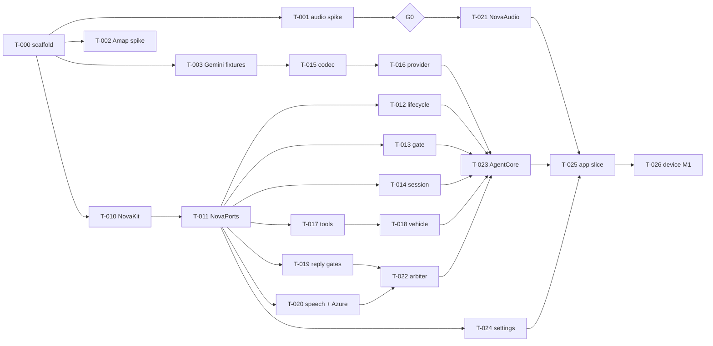

# iOS implementation plan (v1, 2026-10-23)

This breaks [migration-plan.md](migration-plan.md) milestones M0–M7 into task packets that follow the
[ios-architecture.md](ios-architecture.md) structure. Each row is one Executor task in the format of
[ai-agent-workflow.md](ai-agent-workflow.md). The defaults are: at most 3 attempts, 40 minutes, and
the reviewer verdicts PASS / REWORK / BLOCKED / NOT_VERIFIED. Paths are relative to the iOS repo
(`NovaDriveIOS/`). `Core/` is short for `Packages/NovaCore/Sources/`.

## 1. Before any code: prerequisites

| Need | For | Who | Status |
|---|---|---|---|
| A Mac with Xcode (Swift 6) and a physical iPhone; an Apple developer account | all; device rows | OWNER | needed by T-000 |
| Minimum iOS version (iOS 18 proposed) | T-000 | OWNER (OQ-IOS-12) | DECIDED: iOS 18.0 |
| Gemini API key + consent, Azure Speech key + voice | M1 | OWNER | needed by T-003 |
| Amap iOS SDK key (bound to the bundle id) + Amap Web key | M0 spike, M3 | OWNER | needed by T-002 |
| iFlytek iOS SDK downloaded for the same app id | M5 | OWNER (OQ-IOS-1) | needed by T-060 |
| Background SLEEP policy | M5 | OWNER (OQ-IOS-13) | needed by T-062 |
| Apple Music only for named music? | M6 | OWNER (OQ-IOS-7) | DECIDED 2026-10-27: no named music; T-072 not applicable. REOPENED 2026-11-09: named music as 30 s iTunes previews in the app (F-13 §14, T-032b); T-072 still not applicable |
| CarPlay category | M7 | OWNER (OQ-IOS-8) | DECIDED 2026-10-27: skip CarPlay; T-080 not applicable |
| Ephemeral-token backend | release | OWNER (OQ-IOS-15) | not blocking |

The Android test tables (guards, context resolver, vehicle golden files, uplink-gate PCM corpus,
navigation choice tables) come in through EVIDENCE_REQUEST. Ask for them in batches at the start of
each milestone so Executors are not blocked mid-task.

## 2. Gates used below

`build` (swift build / xcodebuild), `unit` (swift test), `contract` (fixture replay), `lint`
(swiftlint --strict), `secrets`, `imports` (ios-architecture §3.2), and `spec-trace` (every
acceptance ID has a test). **S** = simulator test, **D** = device evidence required. A D row stays
NOT_VERIFIED until a device run is attached.

## 3. Milestones and tasks

### M0: scaffold and spikes

| ID | Task | Depends | Owned paths | Acceptance / output | Gates |
|---|---|---|---|---|---|
| T-000 | Repo scaffold: package layout and NovaCore targets (empty), adapter packages, App project, `AGENTS.md`, gate scripts (`imports`, `secrets`, `spec-trace`), CI (macOS: swift test + xcodebuild) | prerequisites | whole tree, `scripts/`, CI config | All gates run green on an empty tree; a planted `import UIKit` in NovaCore fails `imports` | build, unit, lint, secrets, imports |
| T-000c | CI without an iOS build: `run_static.sh` split, `ci.yml` with `static` (Python gates + ai-native checks) and `swift` (Swift 6.1.2, cached) Linux jobs, automatic only while the repo is public, time limits, `check_runners.py` extended; `ai-native.yml` folded in | — | T-000 | `.github/workflows/`, `scripts/gates/`, `AGENTS.md` | [ci-linux.md](ci-linux.md) §6 rows 1–9 | unit, gate, O |
| T-001 | Audio spike app: VP engine, loud 24 kHz playback, 10 silent trials; three AGC configurations; sink node vs tap latency | T-000 | `Spikes/AudioSpike/` | Answers OQ-IOS-3 and OQ-IOS-14 in open-questions.md, with clips and numbers | D |
| T-001a | Echo re-test with the app's real audio setup: `EchoSpike` matches `LiveAudio`, volume and AGC matrix | T-001 | `Packages/NovaAudio/`, `App/NovaDrive/` | F-08 §17 row 12, numbers in open-questions.md | build, D |
| T-002 | Amap hello-route: key from the Keychain at runtime, privacy-compliance calls, multi-route, route-select call, `startEmulatorNavi`, `playNaviSoundString` log | T-000 | `Spikes/AmapSpike/` | Closes the remaining part of OQ-IOS-2; records Amap callback threads | S, D |
| T-003 | Gemini recorder: `URLSessionWebSocketTask` setup + audio + tool call against the live API; save sanitised server messages | T-000 | `Spikes/GeminiRecorder/`, `Packages/NovaRealtime/Tests/fixtures/gemini/` | ≥6 `.jsonl` fixtures: plain turn, tool turn, interrupted, goAway, resumption, 1007 close; no keys or transcripts of real people | secrets |
| **G0** | **Decision gate**: is voice processing good enough (≥9/10 silent trials without the gate opening)? If not, plan AEC3 in NovaAudio (ios-architecture §6.7) | T-001 | — | Written go/no-go per subsystem | OWNER review |

### M1: vertical slice, "talk to 小诺 and turn on the AC, truthfully"

| ID | Task | Feature | Depends | Owned paths | Acceptance | Gates |
|---|---|---|---|---|---|---|
| T-010 | NovaKit: `NovaInstant`, `Clock`/`ManualClock`, `Epoch`, `Generation`, `TurnID`, `CallID`, `JSONValue`, `ToolResult` + codes, `DiagnosticEvent` (no String payloads), `*Tuning` | — | T-000 | `Core/NovaKit/` | Types distinct; `DiagnosticEvent` has no String payloads (test) | build, unit |
| T-011 | NovaPorts: the protocols and `RealtimeEvent` from ios-architecture §4 | — | T-010 | `Core/NovaPorts/` | Compiles under Swift 6 strict concurrency; every type `Sendable` | build |
| T-012 | Listening lifecycle + local intents | F-02 | T-011 | `Core/NovaVoice/Lifecycle/` | F-02 §10 (4 rows) | unit, spec-trace |
| T-013 | Mic gain, 10 ms framer, uplink gate (PCM corpus) | F-03 (logic), F-04 | T-011 | `Core/NovaVoice/Uplink/` | F-04 §10 (3 rows); F-03 frame-size row | unit, spec-trace |
| T-013a | `SpeechClassifier` port + `SpeechConfirmation` gate rule (confirming state, fallback, 抗噪 switch) | F-04a | T-013 | `Core/NovaVoice/Uplink/`, `Core/NovaPorts/` | F-04a §10 rows 5–6 | unit |
| T-013b | `SoundAnalysisSpeechClassifier` (SNAudioStreamAnalyzer); voice processing pinned | F-04a | T-013a | `Packages/NovaAudio/` | F-04a §10 rows 4, 8 | build, D |
| T-013c | Barge-in uses speech confirmation; 音频测试 diagnostics line; 设置 抗噪 switch | F-04a | T-013a | `Core/NovaVoice/Arbiter/`, `App/NovaDrive/` | F-04a §10 rows 3, 7 | unit, S, D |
| T-013d | Noise corpus fixtures + corpus tests | F-04a | T-013a | `Fixtures/audio/noise/`, tests | F-04a §10 rows 1–2 | unit |
| T-013e | Optional Speaker Lock: on-device enrollment and calibration, `SpeakerHold` before upload, wake and stop phrase checks, default off | F-04b | T-013a, T-060a | `Packages/NovaCore/`, `Packages/NovaAsrSherpa/`, `App/NovaDrive/`, `scripts/` | F-04b §8 rows 1–18 | unit, script, build, D |
| T-013f | Speaker model as an Apple-hosted Background Assets pack, downloaded at install; Release builds drop the bundled copy | F-04b §12 | T-013e | `Packages/NovaCore/`, `App/`, `scripts/` | F-04b §12 rows 19–26 | unit, script, build, D |
| T-013g | Calibration progress saved after every line and resumed; warning before 重新录入 | F-04b §13 | T-013f | `Packages/NovaCore/`, `App/NovaDrive/` | F-04b §13 rows 27–36 | unit, build, D |
| T-013h | 校准 scores the same 1 s clip as the live check; an old threshold needs recalibration; 设置 shows the saved calibration; dropped sentences shown on screen | F-04b §14 | T-013g | `Packages/NovaCore/`, `App/NovaDrive/` | F-04b §14 rows 37–46 | unit, build, D |
| T-013i | A threshold calibrated before §14 stays in use (no forced recalibration); 设置 shows it as 整句校准 | F-04b §15 | T-013h | `Packages/NovaCore/`, `App/NovaDrive/` | F-04b §15 rows 47–50 | unit, build, D |
| T-013j | Speaker lock scores the whole utterance with AS-norm against a CN-Celeb cohort and a threshold measured on public data; no 校准 | F-04b §16 | T-013i | `Packages/NovaCore/`, `App/NovaDrive/`, `scripts/` | F-04b §16 rows 51–60 | unit, script, build, D |
| T-013k | Only the driver can interrupt her: dip at once, stop on a voiceprint check of the first 1.0 s of speech with a 1 s EER threshold from CN-Celeb1; a waiting utterance is never dropped when her reply ends | F-04b §17 | T-013j | `Packages/NovaCore/`, `App/NovaDrive/`, `scripts/` | F-04b §17 rows 61–69 | unit, script, build, D |
| T-013l | Early check uses the whole-sentence threshold until threshold1s exists; an early reject/unknown never throws the words away | F-04b §17 amendment | T-013k | `Packages/NovaCore/` | F-04b §17 rows 63-64 | unit, build, D |
| T-013m | Playback bar: while her reply plays or in echoTail the speaker lock needs score >= 4.0 (early stop and whole sentence) | F-04b §18 | T-013l | `Packages/NovaCore/` | F-04b §18 rows 70-72 | unit, build, D |
| T-013n | Echo-aware VAD (double-talk detection against her playback level) and a rolling voiceprint check while she speaks: re-score the latest 1 s every 1 s; the first accepted window stops her and splits the utterance (echo before it dropped); an all-rejected echo utterance is cut at her reply end | F-04b §19 items 0–8 | T-013m | `Packages/NovaCore/`, `App/NovaDrive/` | F-04b rows 72a–79 | unit, build, D |
| T-021q | Another app takes the microphone: stop and wait, resume per iOS; no engine restart while interrupted | F-03 §14 | T-021 | `Packages/NovaAudio/`, `Packages/NovaCore/` | F-03 §14 rows 1-5 | unit, build, D |
| T-014 | `VoiceSession` state machine + `ReconnectPolicy` | F-05 core, F-24 | T-011 | `Core/NovaVoice/Session/` | contracts/voice-agent.md §1 and §8 transitions; auth error → no retry | unit |
| T-015 | Gemini codec, turn assembler, error classifier | F-05 | T-011, T-003 | `Packages/NovaRealtime/Sources/Codec/` | Fixture replay gives the §4 event order; 1007/1008 classification | unit, contract |
| T-016 | Gemini transport + provider; local fake WebSocket server | F-05, F-24 | T-015 | `Packages/NovaRealtime/` | F-05 §10 rows 2–3; F-24 §10 row 1 (W4) | unit, contract |
| T-016g | Callbacks answered once: `ResumeOnce` helper, ping double-callback crash fix, audit of Apple-callback continuations | F-05, F-24 | T-016 | `Packages/NovaRealtime/`, `Packages/NovaPlatform/`, `Packages/NovaAudio/` | F-05 §14 rows 1–8 | unit, review, D |
| T-016h | Wait for the network: `NetworkPathWatcher`, offline wait without spending attempts, immediate reconnect on restore, 10 min offline cap | F-24 | T-016g | `Packages/NovaPlatform/`, `Packages/NovaCore/`, `App/NovaDrive/` | F-24 §14 rows 1–10 | unit, build, D |
| T-016j | Retry for 60 s with the network up, then close the session and keep the handle in memory, so 你好小诺 or a tap connects again and continues | F-24 | T-016h, T-060a | `Core/NovaVoice/Session/`, `Core/NovaKit/`, `App/NovaDrive/` | F-24 §15 rows 1–9 | unit, build, D |
| T-016o | A connection message goes away when she is connected again: 「重新连接中…」 after 1 s, 「已重新连接」 for 3 s, 「连接失败，点按重试」 only for non-retryable codes; no error codes on screen | F-24 §17 | T-016j | `Packages/NovaCore/`, `App/NovaDrive/` | F-24 §17 rows 1–9 | unit, build, D |
| T-016a | `LocalTranscriber` port, `TranscriptSelector`, `TranscriptLanguage`, `wordsReliable` | F-05a | T-016, T-013a | `Core/NovaPorts/`, `Core/NovaVoice/Transcript/`, `Core/NovaTools/Dispatch/` | F-05a §10 rows 1–4 | unit |
| T-016b | CLOSED, replaced by T-016f (bundled recognizer; Apple Speech removed) | F-05a | T-016a | `Packages/NovaAudio/`, `scripts/gates/` | F-05a §4 | build |
| T-016c | CLOSED, replaced by T-016f (bundled recognizer; Apple Speech removed) | F-05a | T-016b | `App/NovaDrive/` | F-05a §10 rows 5–9 | S, D |
| T-016d | Transcript display-only: no tool guard reads it; withdraw `wordsReliable` / `wordsUnclear` | F-05a | T-016a | `Core/NovaTools/Dispatch/`, `Core/NovaAgent/` | F-05a §10 row 4 (revised) | unit |
| T-016e | 结束导航 ends at once: remove the exit confirmation (`CONFIRM_REQUIRED`) | F-05a | T-016d | `Core/NovaTools/Dispatch/` | F-05a §6 (ending navigation) | unit, D |
| T-016f | Bundled sherpa-onnx streaming Mandarin recognizer replaces Apple's (no keyboard dependence, no speech permission) | F-05a | T-016c | `Packages/NovaAsrSherpa/`, `App/NovaDrive/`, `scripts/`, `codemagic.yaml` | F-05a §12 rows 1–10 | unit, gate, build, D |
| T-016i | One check before conversation text is shown: other languages never reach the driver line, reply, guidance or camera text; other scripts void her reply | F-05a | T-016f | `Packages/NovaCore/`, `App/NovaDrive/` | F-05a §13 rows 1–10 | unit, build, D |
| T-016l | Chinese, English and Japanese: SenseVoice downloaded after install (Hugging Face, hf-mirror fallback, SHA-256) gives the final line; screen allows Kana and English; replies in the driver's language; Gemini languageCode removed | F-05a §14 | T-016i | `Packages/NovaCore/`, `Packages/NovaAsrSherpa/`, `Packages/NovaRealtime/`, `App/NovaDrive/` | F-05a §14 rows 1–11 | unit, build, D |
| T-016m | Her reply's language is checked in code before she says it: Apple NLLanguageRecognizer through a port, audio held up to 800 ms for the verdict, a blocked reply voided, one WRONG_LANGUAGE re-ask with SenseVoice's words, then the app's own 「没听清，请再说一遍」 | F-05a §15 | T-016l | `Packages/NovaCore/`, `Packages/NovaPlatform/`, `App/NovaDrive/`, `scripts/gates/` | F-05a §15 rows 1–12 | unit, gate, build, D |
| T-016n | The driver's line on screen is Gemini's transcript only, filtered to Chinese, English and Japanese with the §15 detector; SenseVoice and its download removed (files deleted once); the streaming Chinese model stays for internal use; §15 re-ask without heard words | F-05a §16 | T-016m | `Packages/NovaCore/`, `Packages/NovaAsrSherpa/`, `App/NovaDrive/` | F-05a §16 rows 1–10 | unit, gate, build, D |
| T-022a | Stop phrase while she talks: sherpa keyword spotter on a fixed 7-phrase set, transcript as backup | F-08 | T-016f | `Packages/NovaAsrSherpa/`, `Core/NovaVoice/`, `App/NovaDrive/` | F-08 §14 rows 1–8 | unit, build, D |
| T-022b | Stop phrase also ends the reply for Gemini: START_OF_ACTIVITY_INTERRUPTS + empty activity on a stop, unmute on stop, re-ask names the newest question, scoped abandonNextTurn | F-08, F-06, F-05 | T-022a | `Packages/NovaCore/`, `Packages/NovaRealtime/`, `App/NovaDrive/` | F-08 §15 rows 1–9 | unit, S, D |
| T-022c | After 别说了 nothing is sent until real words: stop utterance held to the pause, 3 s post-stop window with word-gated release (local ASR) or drop, no reply without a sent utterance | F-08, F-04, F-05a | T-022b | `Packages/NovaCore/`, `App/NovaDrive/` | F-08 §16 rows 1–12 | unit, build, D |
| T-022d | Log-only interruption check while she talks: `BargeInCheck`, driver level bar, her recent words, `bargeInShadow` log, 800 ms echo tail, mute-end log; no behaviour change besides the tail | F-08, F-04 | T-022c | `Packages/NovaCore/`, `App/NovaDrive/` | F-08 §17 rows 1–6, 9–11 | unit, build, D |
| T-022e | Live interruption behind a setting: dip, buffered audio, stop on confirmed new words, `echoWords` rule that respects word order. Owner go-ahead 2026-11-02; on by default needs approval of the device numbers | F-08, F-04 | T-022d | `Packages/NovaCore/`, `Packages/NovaAudio/`, `App/NovaDrive/` | F-08 §17 rows 7–8, 13–18 | unit, build, D |
| T-017 | Tool catalog (Android names and schemas byte-for-byte), validation, guards in order, dispatcher decisions, `ToolFailureAdvice`, `NotYetExecutor` | F-09 | T-011 + Android tables | `Core/NovaTools/Dispatch/` | F-09 §10: every guard table ported; sunroof → `UNSUPPORTED_BODY_PART` | unit, spec-trace |
| T-017a | Car tools only for car requests (落域): area per utterance from the local final, comfort tools refused outside `car` with `NOT_A_CAR_REQUEST`, tired utterances silenced in code | F-09a, F-09, F-12, F-05a | T-031i | `Packages/NovaCore/`, `App/NovaDrive/` | F-09a rows 1–10 | unit, build, D |
| T-018 | Climate/seat/window handlers + `SimulatedVehicle` with fault injection | F-11 | T-017 | `Core/NovaTools/Vehicle/`, `Packages/NovaServices/Sources/Vehicle/` | F-11 §10 golden files; `BACKEND_LABEL=simulated` | unit |
| T-019 | Reply pipeline: claim gate, `ActionClaimGuard`, correction grace, empty-response re-ask, phantom gate | F-06 | T-011 | `Core/NovaVoice/Reply/` | F-06 §10 (3 rows); W3 | unit, spec-trace |
| T-020 | Clause segmenter, wait cues, revoicer queue (≤2 in flight, ordered, epoch drop); Azure REST client | F-07 | T-011 | `Core/NovaVoice/Speech/`, `Packages/NovaServices/Sources/Azure/` | F-07 §10 rows 2–3 with fakes; deadline 4000 + 400 ms × chars | unit, contract |
| T-020a | Her voice from 阿里云百炼 qwen-audio-3.1-tts-flash (Singapore host, 龙安 voices) by default, Azure as an option; one retry; voice-failed and timing record lines | F-07 §14 | T-020 | `scripts/tts_eval/`, `Packages/NovaServices/`, `Packages/NovaCore/`, `App/NovaDrive/` | F-07 §14 rows 1–11 | script, unit, build, D |
| T-020b | Her voice is Gemini Live's own voice by default, streamed as it arrives with the claim check cutting a false claim (revoicing off), Qwen and Azure kept as options; clearer missing-setting message; microphone sent to Gemini in 100 ms messages so a long held sentence no longer overflows the outbox; close code logged | F-07 §15, F-24 §16 | T-020a, T-013j | `Packages/NovaCore/`, `Packages/NovaRealtime/`, `App/NovaDrive/` | F-07 §15 rows 12–16; F-24 §16 rows 1–5 | unit, build, D |
| T-020c | Search and live info run in the background as Gemini Live NON_BLOCKING functions answered WHEN_IDLE, other tools stay blocking; keep each reply's received audio as WAV and log the playback format to find the old-woman sound | F-18 §27, F-07 §16 | T-020b | `Packages/NovaCore/`, `Packages/NovaRealtime/`, `Packages/NovaAudio/`, `App/NovaDrive/` | F-18 §27 rows 1–6; F-07 §16 rows 17–18 | unit, build, D |
| T-020d | Remove Azure completely: client, region probe, 她的声音 option and fields, Azure key and settings; a one-time cleanup moves a saved Azure source to Gemini 原声 and deletes the stored key; `AzureSpeechTuning` renamed `SpeechTuning`; the style leaves synthesis (prompt only); a gate test keeps `azure` out of `App/` and `Packages/`; current-behaviour specs updated | F-07 §17 | T-020b | `Packages/NovaServices/`, `Packages/NovaCore/`, `App/NovaDrive/`, `scripts/gates/`, `specs/` | F-07 §17 rows 19–25 | unit, build, D |
| T-020e | Remove 「她的声音」: her voice is always the voice model's own; delete the 千问 TTS client, Revoicer path and settings; one-time cleanup of saved voice values | F-07 §18 items 1–8 | T-020d, T-016r | `Packages/NovaCore/`, `Packages/NovaServices/`, `App/NovaDrive/`, `scripts/gates/` | F-07 rows 26–30 | unit, build, D |
| T-021 | NovaAudio: session policy, VP engine, capture chain (ring, converter, framer hookup), reply lane with epoch flush, session monitor | F-03, F-07 | T-011, G0 | `Packages/NovaAudio/` | Flush drops scheduled buffers (S); F-03 §10 rows 1–2 (D) | build, S, D |
| T-022 | Minimal arbiter: barge-in qualification, flush-then-notify order, R4/R5 mapping | F-08 | T-019, T-020 | `Core/NovaVoice/Arbiter/` | W2 with fakes; effect order test | unit |
| T-023 | NovaAgent: `AgentCore`, `EffectRunner`, `ToolRunner`, `TimerService`; integration with scripted fakes | — | T-012..T-022 | `Core/NovaAgent/` | W1, W2, W3 pass end to end without audio | unit |
| T-024 | Settings: Keychain/Defaults stores, `CredentialWipe`, `SettingsReadiness`; Gemini + Azure cards | F-22 | T-011 | `Packages/NovaServices/Sources/Stores/`, `Core/NovaAgent/Settings/`, `App/Settings/` | F-22 §10 (3 rows) | unit, S, secrets |
| T-025 | App slice: composition root, tap-to-talk, status chip + bubble, debug hooks | F-25 subset | T-021, T-023, T-024 | `App/` | Chip mapping identical (unit); bubble fade constants (unit) | build, unit, S |
| T-026 | M1 device acceptance + latency | — | T-025 | `UITests/Device/`, `specs/STATUS.md` | W1–W4 on a device; V-LAT median over 20 turns recorded; barge-in ≤300 ms measured | D |

**M1 exit:** W1–W4 PASS at D level; F-02/F-04/F-06/F-09/F-11 unit suites green in CI.

### M2: tools without navigation

| ID | Task | Feature | Depends | Owned paths | Acceptance | Gates |
|---|---|---|---|---|---|---|
| T-030 | Driver context + context resolver | F-10 | T-018 | `Core/NovaTools/Context/` | F-10 §10 (3 rows), including the misheard 「第一点」 | unit |
| T-031 | Comfort scenarios | F-12 | T-018 | `Core/NovaTools/Scenarios/` | F-12 §10 golden files; partial → no full claim | unit |
| T-031a | Comfort test set of 55+ cases, outcome scorer, in-app runner, baseline score on the fixed table | F-12 | T-031 | `Packages/NovaCore/`, `App/NovaDrive/` | F-12 §14 rows 1, 2, 7 | unit, build, D |
| T-031b | Model-chosen comfort actions behind a setting: catalog variant, `get_vehicle_state`, goal prompt, `VehicleActionPolicy`, claims per tool | F-12, F-09, F-21, F-06 | T-031a | `Packages/NovaCore/`, `App/NovaDrive/` | F-12 §14 rows 3–9 | unit, build, D |
| T-031d | Comfort tuning round: test reports failure causes and stage times, 10 fresh held-out cases, tune on tuning cases only, score both versions again | F-12 | T-031b | `Packages/NovaCore/`, `App/NovaDrive/` | F-12 §15 rows 1–7 | unit, build, D |
| T-031e | Trustworthy comfort test (end of reply, decision reading, checked scorer, 100 cases, consistency, paired comparison, clean runs), small model fixes on tuning cases, score both versions | F-12 | T-031d | `Packages/NovaCore/`, `App/NovaDrive/` | F-12 §16 rows 1–9 | unit, build, D |
| T-031f | Conversation record for testing: an off-by-default setting saves what she heard, said and did to a file on the phone | F-12 | T-031d | `Packages/NovaCore/`, `App/NovaDrive/` | F-12 §17 rows 1–7 | unit, build, D |
| T-031g | Window and climate tool descriptions say what the tool is for, in model mode only | F-12 | T-031f | `Packages/NovaCore/` | F-12 §18 rows 1–3 | unit, build, D |
| T-031h | Sleepy driver in model mode: no lower temperature in rule 5 | F-12 | T-031g | `Packages/NovaCore/` | F-12 §19 row 1 | unit, build |
| T-031i | Sleepy driver: no action and no reply (both modes) | F-12 | T-031h | `Packages/NovaCore/` | F-12 §20 rows 1-4 | unit, build, D |
| T-031c | Make model-chosen actions the only path and remove the table. Starts only after owner approval of the numbers | F-12, F-09 | T-031b | `Packages/NovaCore/`, `App/NovaDrive/`, `specs/` | F-12 §14 items 14–15 | unit, build, D |
| T-031j | Undo in one sentence (`undo_last_change`, one kept change set, 5 min) and the car-state note every changed turn | F-09b §4-5 | T-031c | `Core/NovaTools/Vehicle/`, `Core/NovaTools/Dispatch/`, `Core/NovaAgent/` | F-09b §9 rows 3-5, 9 | unit, build, D |
| T-031k | A sleepy driver gets a one-sentence rest suggestion and nearby coffee shops or rest areas on screen via navigate_to; no car change; ten sleepy comfort cases updated | F-09b §12 | T-031c | `Packages/NovaCore/` | F-09b §12 rows 1–7 | unit, eval, build, D |
| T-031l | Own-words replies, stage 1: `ToolReply` (facts, may, must_not), base instruction rules, not-found and failed lookups; script gate (report only) | F-09b §13 | T-031c | `Packages/NovaCore/`, `scripts/gates/` | F-09b §13 rows 1–4, 9, 10 | unit, eval, build, D |
| T-031m | Own-words replies, stage 2: not done / not yet, and choosing | F-09b §13 | T-031l | `Packages/NovaCore/` | F-09b §13 rows 5, 9, 11, 13 | unit, eval, build, D |
| T-031n | Own-words replies, stage 3: success confirmations; script gate made failing | F-09b §13 | T-031m | `Packages/NovaCore/`, `scripts/gates/` | F-09b §13 rows 6, 8, 9, 12 | unit, eval, build, D |
| T-031o | Own-words replies, stage 4: `ToolFailureAdvice` table as may/must_not | F-09b §13 | T-031n | `Packages/NovaCore/` | F-09b §13 rows 7, 9 | unit, eval, build |
| T-031p | Stage A: `[系统] 现在` context note, `AskOrActEval`, complaint set, baseline eval | F-09b §14 | T-031o | `Packages/NovaCore/`, `App/NovaDrive/` | F-09b §14 rows 1–4 | unit, eval |
| T-031q | Stage B: base instruction rewritten (who, what she has, how she decides, safety); no phrase scripts | F-09b §14 | T-031p | `Packages/NovaCore/` | F-09b §14 rows 5, 7, 8 | unit, eval, build, D |
| T-031r | Stage C: car tool descriptions as purpose / when / parameters / result | F-09b §14 | T-031q | `Packages/NovaCore/` | F-09b §14 rows 6, 7, 10 | unit, eval, build, D |
| T-031s | Stage D: navigation, trip and live-info tool descriptions; 「不要反问去哪里」 removed | F-09b §14 | T-031r | `Packages/NovaCore/` | F-09b §14 rows 6, 7, 9, 10 | unit, eval, build, D |
| T-031t | Stage E: `offer_choices` (code reads the pick and runs the action), `suggest_destinations`, `find_rest_stop`, `make_trip_list` DESTINATION_MISSING | F-09b §14E | T-031s | `Packages/NovaCore/`, `App/NovaDrive/` | F-09b §14 rows 11–22 | unit, eval, build, D |
| T-031u | Record format version in every record file, format fixture test and gate, PC collector and archive by build and format, one reader per format | F-12 §21 | — | `Packages/NovaCore/`, `App/NovaDrive/`, `scripts/records/`, `scripts/gates/` | F-12 §21 rows 1–8 | unit, gate, D |
| T-031y | Agent setup version: `AgentSetup` parts, `agentHash`, registry `agent-versions.md` with bump rules, gate test and `check_agent_version.py`, record header and log line, PC reader columns | F-09b §15 | T-031u | `Packages/NovaCore/`, `App/NovaDrive/`, `scripts/records/`, `scripts/gates/` | F-09b §15 rows 1–8 | unit, gate, build, D |
| T-031zc | `show_place(name, city)`: exact 高德 lookup in her city; one exact name+city match shows the card, else `PLACE_UNSURE` with found (no card, no nationwide first result); next sends her to web_search for the city; record; PC real-data check | F-09b §18 items 1–8 | T-031za | `Packages/NovaCore/`, `scripts/` | F-09b §18 rows 1–8 | unit, PC, eval, D |
| T-031zd | `show_on_map(name, city)`: §18 lookup shared; sure -> one green pin and a small card (name, district, distance, ×) on the main map, no route request; camera frames car and pin, follow paused; `mapPin` panel (layer 1, closes on ×/关掉/navigate_to list); result next says no navigation started; `navigate_to` description points to it; record; agent minor bump | F-09b §19 items 1–7 | T-031zc | `Packages/NovaCore/`, `App/NovaDrive/` | F-09b §19 rows 1–9 | unit, gate, eval, D |
| T-031ze | Tool texts only: `show_places` says each place is a card with photos and is used when the driver asks to see pictures of places she named; `show_place` pictures wording points to `show_places` for several; `web_search` 「事实只按 answer 回答」, the answer's words about its own abilities are not about her; agent version bump and parts | F-09b §20 items 1–4 | T-031zd | `Packages/NovaCore/` | F-09b §20 rows 1–4 | unit, eval, D |
| T-031zf | Every ok `web_search` result carries the `next` 「answer 里有地点时，用 show_places 把它们列在屏幕上（每个是带照片的卡片），再简短说找到了哪些。」 when `show_places` is declared; live PoC 0/5 → 5/5 | F-09b §21 items 1–3 | T-031ze | `Packages/NovaCore/` | F-09b §21 rows 1–3 | unit, eval, D |
| T-031zg | A 「×」 the driver taps on every panel she can close (destinationList, routePicking, tripScreen, tripDetail, tripPlans, musicCard; camera and mapPin keep theirs), through §17's one close path, no model call; record `panel close tap` | F-09b §22 items 1–5 | T-031zd | `App/NovaDrive/`, `Packages/NovaCore/` | F-09b §22 rows 1–4 | unit, D |
| T-016p | In-memory summary of the last 6 exchanges for a new session without a resumption handle (30 min) | F-09b §6 | T-031c | `Core/NovaAgent/`, `App/NovaDrive/` | F-09b §9 rows 6, 10 | unit, build, D |
| T-016q | Voice model picker: Gemini 3.8 Live / Qwen Audio 3.1 Flash / Plus; `QwenRealtimeProvider` behind `RealtimeProvider`; PC check before the build | F-05 §15 items 1–7 | T-016p | `Packages/NovaRealtime/`, `Packages/NovaCore/`, `App/NovaDrive/` | F-05 rows 9–16 | unit, PC, D |
| T-016r | Qwen voice model connects to `wss://dashscope.aliyuncs.com/api-ws/v1/realtime` (fixed, as `QwenRoute`), not the saved 千问 voice API Host; Qwen choice needs only the 百炼 key | F-05 §15 (vendor facts, item 1) | T-016q | `Packages/NovaRealtime/`, `Packages/NovaCore/`, `App/NovaDrive/` | F-05 rows 10, 16 | unit, D |
| T-017c | Withdraw the 落域 word-list areas, `NOT_A_CAR_REQUEST` and the tired silence in code | F-09b §7, F-09a | T-031j | `Core/NovaAgent/`, `Core/NovaTools/Dispatch/`, `App/NovaDrive/` | F-09b §9 rows 7, 11 | unit, build |
| T-032 | Bundled music on the media lane; `control_music` | F-13 | T-021 | `Core/NovaTools/Media/`, `Packages/NovaAudio/Sources/MediaLane/` | F-13 §10 row 1 offline; no self barge-in during music (D) | unit, D |
| T-032b | Named music as 30 s iTunes Search API previews streamed inside the app: `ITunesPreviewMusic` as `NamedMusicPort`, pick by title and artist, media lane, now-playing proof, card with iTunes attribution and Apple Music link | F-13 §14 | T-032, T-020c | `Packages/NovaServices/`, `Packages/NovaAudio/`, `Packages/NovaCore/`, `App/NovaDrive/` | F-13 §14 rows 1–11 | unit, build, D |
| T-032c | Named music finds the song: Hong Kong catalogue by default (CN removed, it returns nothing), Gemini names a real title, one title-only retry, clearer not-found advice | F-13 §15 | T-032b | `Packages/NovaServices/`, `Packages/NovaCore/`, `App/NovaDrive/` | F-13 §15 rows 1–6 | unit, build, D |
| T-032d | The iTunes preview plays through LiveAudio's voice-processing engine (preview node on the media lane, downloaded and decoded in memory), so it is in the echo reference and stopped like the bundled track | F-13 §16 | T-032b | `Packages/NovaAudio/`, `App/NovaDrive/`, `scripts/gates/check_imports.py` | F-13 §16 rows 1–5 | unit, build, D |
| T-032e | The iTunes preview streams: parsed and played as it downloads (AudioFileStream + AVAudioConverter on the preview node, whole-file fallback for moov-last files); failure stage logged to the record; honest NOT_PLAYING advice (no 版权/会员) | F-13 §17 | T-032d | `Packages/NovaAudio/`, `Packages/NovaCore/`, `Packages/NovaServices/`, `Packages/NovaCore/Sources/NovaTools/Media/` | F-13 §17 rows 6–14 | unit, build, D |
| T-032f | The preview plays from our own buffer through an AVAudioSourceNode; one serial queue for every media-lane command; a stop empties the buffer and never stops a player node (fixes the freezes of 2026-11-09 when music was changed during a preview); slow-command record line | F-13 §18 | T-032e | `Packages/NovaAudio/`, `Packages/NovaCore/`, `scripts/gates/` | F-13 §18 rows 15–25 | unit, gate, build, D |
| T-032g | Two app volumes (media 0–10, voice 2–10) as lane gains in LiveAudio; `set_volume` tool; dip × voice gain; 设置 sliders | F-13a | T-032f | `Packages/NovaCore/`, `Packages/NovaAudio/`, `App/NovaDrive/` | F-13a §8 rows 1–5, 8, 10–12 | unit, build, D |
| T-032h | The song is ducked under her voice and guidance (relative, ramped) | F-13a | T-032g | `Packages/NovaAudio/`, `Packages/NovaCore/` | F-13a §8 rows 6, 7, 9 | unit, build, D |
| T-032i | Build stamp in 设置 and the record; declared tools in the record; 音量 in her tool rules and the claim checker (volume on the phone) | F-13a | T-032g | `App/`, `codemagic.yaml`, `Packages/NovaCore/` | F-13a §10 rows 13–17 | unit, build, D |
| T-090 | Remove unused code: `MusicKitPlayer` and the CarPlay scene deleted; 音频测试 and 录制 moved from the tab bar to 设置 → 开发 | F-25 §14 | T-032b | `Packages/NovaPlatform/`, `App/NovaDrive/`, `scripts/gates/check_imports.py` | F-25 §14 rows 1–4 | unit, build, D |
| T-033 | Amap Web client (weather, regeo) + live-info weather | F-18 | T-017 | `Packages/NovaServices/Sources/AmapWeb/`, `Core/NovaTools/LiveInfo/` | 4 s timeout → honest failure; TTLs 10/30 min | unit, contract |
| T-034 | Persona and speaking style | F-21 | T-017 | `Core/NovaTools/Persona/` | F-21 §10 (3 rows) | unit |
| T-034a | Base instruction scope: strict for car/navigation/weather/location, natural 3–5 sentence answers for general questions | F-21 | T-034 | `App/NovaDrive/` | F-21 §14 rows 1–8 | unit, S, D |
| T-034b | Camera questions in the strict scope: camera topic + rule 8 (`describe_camera_view`), exclusion in the other scope, `toolCall` diagnostic, catalog-coverage guard test | F-21, F-20a | T-034a | `Packages/NovaCore/Sources/NovaAgent/Persona/` | F-21 §15 rows 1–8 | unit, S, D |
| T-034c | A new tone applies at once in the same conversation: `contextUpdate` after the confirmation turn, re-sent after a resumed setup | F-21, F-05, F-24 | T-034b | `Packages/NovaCore/`, `Packages/NovaRealtime/`, `App/NovaDrive/` | F-21 §16 rows 1–11 | unit, build, D |
| T-034d | Remove the mid-conversation tone update (§16): no `contextUpdate`; honest confirmation lines; 设置 note; tone from the next session | F-21 | T-034c | `Packages/NovaCore/`, `Packages/NovaRealtime/`, `App/NovaDrive/` | F-21 §17 rows 1–6 | unit, build, D |
| T-035 | M2 device run | — | T-030..T-034 | `specs/STATUS.md` | W6 on a device | D |

### M3: navigation core

| ID | Task | Feature | Depends | Owned paths | Acceptance | Gates |
|---|---|---|---|---|---|---|
| T-040 | `NavigationController` phase machine + `NavigationActor` + `ScriptedNaviEngine` | F-15 | T-011, T-002 | `Core/NovaNav/Flow/`, `Core/NovaAgent/Navigation/` | contracts/navigation.md transitions; W8; no double start | unit |
| T-041 | Choice resolver (index/preference/name), 120 s expiry, picker intercept, 5 s duplicate suppression | F-15 | T-040 | `Core/NovaNav/Choice/` | Ported choice tables; `OPTIONS_STALE` | unit |
| T-042 | Destination queries, saved places, along-route corridor, WGS-84→GCJ-02; `CoreLocationProvider` | F-16 | T-033 | `Core/NovaNav/Search/`, `Packages/NovaPlatform/Sources/Location/` | F-16 §10 (4 rows) | unit, contract |
| T-042c | No route to a nonsense place: near-first search, sound-alike score with distance, confirm by score, far places need a yes, km and hours in the start sentence | F-16 | T-042 | `Core/NovaNav/Search/`, `Core/NovaNav/Flow/`, `Packages/NovaServices/`, `App/NovaDrive/` | F-16 §14 rows 1–8 | unit, PC, D |
| T-042d | Explore: 「附近有没有滑雪的」 → `web_search` → `show_places` list with what each is, no route; `navigate_to` only after the driver says go; §14 never says found=0 when 高德 returned places | F-16 | T-042c | `Core/NovaNav/Flow/`, `Core/NovaAgent/`, `App/NovaDrive/` | F-16 §15 rows 1–5 | unit, eval, D |
| T-042a | `CoreLocationProvider` first-fix wait, authorization changes, denied state; `SwitchableLocationProvider` | F-16a | T-042 | `Packages/NovaPlatform/Sources/Location/`, `Core/NovaNav/Search/` | F-16a §10 rows 5–7 | unit, build |
| T-042b | 设置 → 位置来源, permission state, 打开系统设置; 演示位置 header label | F-16a | T-042a | `App/NovaDrive/` | F-16a §10 rows 1, 4 | S, D |
| T-043 | `AmapNaviEngine` adapter with generation tagging | F-15 | T-040, T-002 | `Packages/NovaNavAmap/Sources/Engine/` | Stale callback dropped (S) | build, S, imports |
| T-044 | `AmapMapView` + `MapPresentationPolicy` | F-15, F-25 | T-043 | `Packages/NovaNavAmap/Sources/Map/`, `Core/NovaNav/Presentation/` | No route drawn after 算了 (S) | S |
| T-044a | `SelfPosition` + `MapCameraPolicy` + `LocationUpdates` port | F-16b | T-044, T-042a | `Core/NovaNav/Presentation/`, `Core/NovaPorts/` | F-16b §10 rows 3–5 | unit |
| T-044b | Location updates stream in `CoreLocationProvider`, `DemoLocation`, `SwitchableLocationProvider` | F-16b | T-044a | `Packages/NovaPlatform/Sources/Location/`, `Core/NovaNav/Search/` | F-16b §4 | unit, build |
| T-044c | `DriveView` 我的位置 dot, accuracy circle, locate-me, 定位未开启, follow/free camera | F-16b | T-044a, T-044b | `App/NovaDrive/` | F-16b §10 rows 1–2, 6–9 | S, D |
| T-040a | `NavigationModeSetting`, `RouteProgress`, `SelfPosition` mode input | F-15a | T-044a | `Core/NovaNav/Flow/`, `Core/NovaNav/Presentation/` | F-15a §10 rows 1–3 | unit |
| T-040b | Guards `navigationNotRequested`, `wordsUnclear` | F-15a | T-016a | `Core/NovaTools/Dispatch/` | F-15a §10 row 4 | unit |
| T-040c | `AmapRouteEngine` `.gps` path with reroute | F-15a | T-040a, T-044b | `Packages/NovaServices/Sources/NovaServices/AmapWeb/` | F-15a §10 row 5 | unit |
| T-040d | 设置 导航方式, 演示起点 lock, HUD labels | F-15a | T-040a, T-040c | `App/NovaDrive/` | F-15a §10 rows 6–11 | S, D |
| T-040e | Start guard on driver turns (no transcript); claim held after refusal | F-15a | T-040b, T-016d | `Core/NovaTools/Dispatch/`, `Core/NovaVoice/Uplink/` | F-15a §10 row 4 (revised), row 12 | unit, D |
| T-040f | Driver turns only from real driver speech; `routeListTurn` set on `destination_selected` | F-15a | T-040e | `Core/NovaAgent/Core/`, `Core/NovaVoice/Uplink/` | F-15a §10 rows 13–14 | unit, D |
| T-040g | One trip at a time: engine + controller app-owned, sessions attach | F-15a | T-040d | `App/NovaDrive/`, `Packages/NovaServices/Sources/NovaServices/AmapWeb/` | F-15a §10 rows 15–16 | unit, build, D |
| T-040h | Route choice dropped: start on the recommended route; choose while navigating replaces the route | F-15a | T-040e | `Core/NovaNav/Flow/`, `Core/NovaTools/Dispatch/` | F-15a §10 rows 10, 12 (revised) | unit, D |
| T-040i | Trip list and multi-stop route, phase 1 (voice): `TripList`, name resolving, `make_trip_list` / `edit_trip_list` / `route_trip`, `RouteRequest.waypoints` (高德 ≤ 16), stops passed and recalculation | F-15b | T-040h | `Core/NovaNav/`, `Core/NovaTools/Dispatch/`, `Core/NovaPorts/`, `Packages/NovaServices/Sources/NovaServices/AmapWeb/`, `App/NovaDrive/` | F-15b §9 rows 1-15 | unit, build, D |
| T-040j | Trip phase 2a: poster cards with 高德 place photos, the moving strip (8 km/h), editing on screen through `UIIntent` (remove, move, route, add), tap note, numbered pins and 途经 labels | F-15b | T-040i | `Core/NovaNav/`, `Core/NovaAgent/Core/`, `Packages/NovaServices/Sources/NovaServices/AmapWeb/`, `App/NovaDrive/` | F-15b §19 rows 16-25 | unit, build, D |
| T-040l | Trip phase 2b: the plan saved on the phone, named plans and days (1–5), `trip_plans` tool, load/save record lines | F-15b | T-040j | `Core/NovaNav/`, `Core/NovaTools/Dispatch/`, `App/NovaDrive/` | F-15b §19 rows 26-35 | unit, build, D |
| T-040m | Trip phase 2c (device 2026-11-17): card tap opens the details, spot introduction from the Qwen web search, 「把页面关掉」 puts the trip cards away and 「行程」 brings them back | F-15b | T-040l | `Core/NovaNav/`, `Core/NovaTools/Dispatch/`, `App/NovaDrive/` | F-15b §23 rows 54-64 | unit, build, D |
| T-040n | Trip phase 3: plan ordered by real driving time from the current position (高德 distance), `reorganize` and `move to_day` keeping the same places, `trip_next` one stop at a time with arrival marks; removes `route_trip` and trip 途经点 | F-15b | T-040m | `Core/NovaNav/`, `Core/NovaTools/Dispatch/`, `Core/NovaPorts/`, `Packages/NovaServices/Sources/NovaServices/AmapWeb/`, `App/NovaDrive/` | F-15b §33 rows 65-83 | unit, build, D |
| T-040o | Trip phase 4: trips abroad through Apple place search chosen by an `abroad` flag (China incl. 港澳台 stays 高德), wrong-country guard, start/hotels/end frame with hotels picked near each night, 300 km start rule, Apple Maps hand-off when 高德 guidance fails abroad, re-ask with the driver's words | F-15b | T-040n | `Core/NovaNav/`, `Core/NovaPorts/`, `Core/NovaTools/Dispatch/`, `Core/NovaVoice/`, `Packages/NovaPlatform/`, `App/NovaDrive/`, `scripts/gates/check_imports.py` | F-15b §43 rows 84-98 | unit, build, D |
| T-040p | Trips and plain searches abroad on OpenStreetMap: Photon place search, OSRM driving times with a straight-line estimate fallback, `navigate_to` `abroad`/`city` | F-15b | T-040o | `Core/NovaNav/`, `Core/NovaTools/Dispatch/`, `Packages/NovaServices/`, `App/NovaDrive/` | F-15b §43 rows 84b-84f, 96 | unit, build, D |
| T-040q | Car rental in a trip: `rental` flag, pickup near the start and return near the end, fixed in the order, 租 label | F-15b §45 | T-040p | `Core/NovaNav/`, `Core/NovaTools/Dispatch/`, `App/NovaDrive/` | F-15b §45 rows 99-104 | unit, build, D |
| T-040r | Photos abroad from Wikipedia (2 km check) and a kind-of-place icon placeholder | F-15b §46 | T-040p | `Core/NovaPorts/`, `Core/NovaNav/`, `Packages/NovaServices/`, `App/NovaDrive/` | F-15b §46 rows 105-110 | unit, build, D |
| T-040s | Guidance abroad inside the app on OSRM routes, zh-Hans osrm-text-instructions prompts, Apple Maps only when OSRM fails | F-15b §47 | T-040p | `Core/NovaPorts/`, `Core/NovaNav/`, `Packages/NovaServices/`, `App/NovaDrive/` | F-15b §47 rows 111-116 | unit, build, D |
| T-040t | Fit each day to a time budget: visit minutes, optional places, spare, load in `next` | F-15b §48 | T-040q, T-040r | `Core/NovaNav/`, `Core/NovaTools/Dispatch/`, `Packages/NovaServices/` | F-15b §48 rows 117-126 | unit, build, D |
| T-040u | The model revises the plan after code checks it: importance, wishes, score-based fit with exchanges, checks fed back, `revise_trip_list`, 2 rounds | F-15b §49 | T-040t | `Core/NovaNav/`, `Core/NovaTools/Dispatch/`, `Packages/NovaServices/` | F-15b §49 rows 127-139 | unit, build, D |
| T-040v | Trips abroad: places and hotels from Qwen with web search; hotel_near (hotels within 1 km of a named place); lookups kept inside the trip country and 50 km box; far check so one bad place never breaks other days; one spoken line first; one Qwen model per job (ground: qwen3.7-plus, agent search, 30 s) | F-15b §50 | T-040u | `Packages/NovaCore/`, `Packages/NovaServices/`, `App/NovaDrive/` | F-15b §50 rows 140–148, 151–152, 154–155, 160 | unit, build, D |
| T-040w | Steps on screen while she works: trip steps and query_live_info steps (WorkProgress, shown after 1 s) | F-15b §50 | T-040v | `Packages/NovaCore/`, `App/NovaDrive/` | F-15b §50 rows 149–150, 153 | unit, build, D |
| T-040x | Backup Qwen model when a model's rate limit (429) or free quota (403) is hit, before any answer; one switch, remaining time only, 60 s skip after 429 | F-15b §50 | T-040v | `Packages/NovaRealtime/`, `Packages/NovaCore/` | F-15b §50 rows 156–159 | unit, build |
| T-040y | Plain navigation separate from the trip (附近 = the phone); trip commands only while the trip is shown; a restored trip starts hidden; nothing else starts from a trip place after a trip drive (empty-result line moved to T-031l) | F-15b §51 | T-040x | `Packages/NovaCore/`, `App/NovaDrive/` | F-15b §51 rows 161–168, 170–175 | unit, build, D |
| T-040z | Where a search is centred: `navigate_to` `near` (here/place/trip/route) chosen by the model; code resolves the coordinates, picks 高德 or Photon by the centre's country, checks country and range, and returns where it searched; `abroad`/`city` removed; NearEval | F-15b §51 item 8 | T-040y, T-031l | `Packages/NovaCore/`, `App/NovaDrive/` | F-15b §51 rows 176–188 | unit, eval, build, D |
| T-040za | Cards shown: `navigate_to near=here` searches around the trip location (simulated car in a trip drive, else the next stop); cards hidden: the phone | F-15b §51 item 9 | T-040z | `Packages/NovaCore/`, `App/NovaDrive/` | F-15b §51 rows 190–194 | unit, build, D |
| T-040zb | The plan is one data structure: stops with id/role/placed/picked_by; whole plan in every trip result; `set_trip_plan` writes it (known ids kept, new names looked up, not found kept unplaced); checks (one start/end, one hotel per night), driver hotel wins, removed reported; old edit actions removed | F-15b §52 items 1–8, 14 | T-040za | `Packages/NovaCore/`, `App/NovaDrive/` | F-15b §52 rows 195–198, 200, 201 | unit, build |
| T-040zc | Trip screen and reads from the whole plan; a day tap only changes the day in front; empty day and unplaced stop shown | F-15b §52 item 9 | T-040zb | `Packages/NovaCore/`, `App/NovaDrive/` | F-15b §52 rows 199, 207 | unit, build, D |
| T-040zd | Stops by id; Photon split searches the non-CJK part; 3 s per try with a new connection, per-name limit, 4 at once, warm-up while a trip abroad is shown; `search_slow` not `nomatch` | F-15b §52 items 10–11 | T-040zb | `Packages/NovaCore/`, `Packages/NovaServices/` | F-15b §52 rows 202–204 | unit, eval |
| T-040ze | No "done" reply before a trip tool's result; clearing the whole trip asks first | F-15b §52 items 12–13 | T-040zb | `Packages/NovaCore/` | F-15b §52 rows 205, 206 | unit, eval |
| T-040zf | Full days: multi-day plans as a pool with `day_count` (catalog example), thin day under 75% of the budget or fewer sights than the pace (relaxed 2, normal 3, packed 4) with room left; agent 5.2.0 | F-15b §53 items 1–6 | T-040zb | `Packages/NovaCore/` | F-15b §53 rows 208–217 | unit, eval, D |
| T-040zg | A trip to a new place is a new plan: make_trip_list and set_trip_plan texts say when to use each; set_trip_plan refuses new stops in another country group or 300+ km from the kept stops (PLAN_CHECK new_trip, nothing saved); agent 5.3.0 | F-15b §54 items 1–6 | T-040zb | `Packages/NovaCore/` | F-15b §54 rows 218–224 | unit, eval, D |
| T-040zh | The model writes every plan, new or changed, with `set_trip_plan` (city, hotel by name or near); code places names inside the city and checks (empty, over, under, driving, not found, hotel → trip_needs_fix, 2 rounds), never moves days, no NO_START; no done-claim with issues; `make_trip_list`/`edit_trip_list` removed; agent 6.0.0 | F-15b §55 items 1–15 | T-040zg | `Packages/NovaCore/` | F-15b §55 rows 225–236 | unit, eval, D |
| T-040zi | What a trip result shows, `set_trip_plan` accepts (id wins, other shown fields ignored or applied); only real checks refuse; every `INVALID_FIELDS` has `problems` (day, stop, field); a refused call is not run twice | F-15b §56 items 1–7 | T-040zh | `Packages/NovaCore/` | F-15b §56 rows 237–244 | unit, D |
| T-040zj | 结束导航 button wherever navigation can start; 去下一站 apart from the cards and toggling to 结束导航; no restart toward the stop already guided; `tripNextButton` / `stopNavigationButton` in the screen state; tap lines | F-15b §57 items 1–7 | T-040zh | `Packages/NovaCore/`, `App/NovaDrive/` | F-15b §57 rows 245–251 | unit, build, D |
| T-040zk | Trip-change claims need an ok `set_trip_plan` (refusals count over the driver request); no invented background work; she says she is changing the trip while it runs; work-panel steps and a failure line for every trip edit | F-15b §58 items 1–7 | T-040zi | `Packages/NovaCore/`, `App/NovaDrive/` | F-15b §58 rows 252–258 | unit, build, D |
| T-040zl | Picker on `qwen3.8-flash` (qwen3.7-flash answers none for every place); no picker backup (429 → 高德's first result); `model=` on the `trip pick` line | F-15b §59 items 1–4 | T-040zb | `Packages/NovaRealtime/`, `Packages/NovaCore/` | F-15b §59 rows 259–262 | unit, PC, D |
| T-040zm | Trip work panel on only while a `set_trip_plan` call runs; off on any result (incl. `trip_needs_fix`) and when the trip screen closes; `working` in the screen state; no carry-over or 120 s timer for trip work | F-15b §60 items 1–5 | T-040zk | `Packages/NovaCore/`, `App/NovaDrive/` | F-15b §60 rows 263–267 | unit, build, D |
| T-040zn | `set_trip_plan` saves and reports without checks (`saved`, no `issues` / `trip_needs_fix` / rounds); new read-only `check_trip_plan` counting tool the model calls (per-day sight, driving, total and budget minutes, not found, hotels; numbers only, draft or current plan); the driver's request saved with the plan as `asked` (results, saved plans, 现在 note); she reviews her plan against `asked` and revises before speaking (`plan_text`, review `next`, stop-revising text from the 3rd save), success judged by her; `removed` over the driver request; 「行程已更新」/「没保存」 panel lines; record `saved`; major agent version | F-15b §61 items 1–9 | T-040zm | `Packages/NovaCore/`, `App/NovaDrive/` | F-15b §61 rows 268–278 | unit, eval, D |
| T-004i | Listening while she talks: one send decision, drop together, cut at unmute, your-turn indicator, per-utterance log (replaces T-040f mute) | F-04 | T-040f | `App/NovaDrive/`, `Core/NovaAgent/Core/`, `Core/NovaVoice/Uplink/` | F-04 §14 rows 1–9 | unit, build, D |
| T-040zo | `plan_trip` carries the driver's request (`asked` / `change`), not the plan; `qwen3.8-flash` planner writes the plan in its own shape (days of sights + stay, a stay may be a sight), code looks up each stop by its city and counts (高德 driving, budget B, found names) every round with no verdict, the planner revises, bounded at 3 rounds; result `plan_text` + planner `note` + `next` for her to tell the driver; `PLANNER_FAILED`, no fallback planner; trip claims judged only by §58's trip verdict (no false `CLAIM_AFTER_FAILURE`); handoff line said by code and a spinner with one line of step text (豆包 style) on top of any screen while background work runs; record lines; `set_trip_plan` out of the catalog, major agent version | F-15b §62 items 1–13 | T-040zn | `Packages/NovaCore/`, `Packages/NovaRealtime/`, `App/NovaDrive/` | F-15b §62 rows 279–291 | unit, eval, D |
| T-040zp | The same place twice in a row in a day is one stop, merged by code in the one save function (same `Place.id` or same found name); a hotel wins and keeps the sight's minutes, counted once; the start and night hotel of a day are not merged; cards, pins, `plan_text` and the planner counts use the merged plan; §62 row 281's text replaced | F-15b §63 items 1–5 | T-040zo | `Packages/NovaCore/`, `App/NovaDrive/` | F-15b §63 rows 292–296 | unit, D |
| T-040zq | Trips with time-limited events: `asked.start` and `stay_city`; events from the F-18 §35 store (browse on a miss inside `plan_trip`); planner `event` field; code counts event dates and store membership and the stay city each round, facts only; event cards show dates | F-15b §64 items 1–6 | T-040zp, T-046x | `Packages/NovaCore/`, `App/NovaDrive/` | F-15b rows 297–302 | unit, eval, D |
| T-040zw | Macau/Hong Kong 高德 results kept by province name (v3 gives no adcode); record shows what the filter dropped; no claim of unplaced stops | F-15b §70 items 1–3 | T-040zu | `Packages/NovaCore/`, `Packages/NovaServices/` | F-15b rows 329–334 | unit, PC, D |
| T-040zx | Macau/Hong Kong: SAR lookups by city aliases, no-city 高德 with retry and name check (高德 only); legs touching a SAR on OSRM (converted points) with in-app guidance; border note | F-15b §71 items 1–6 | T-040zw | `Packages/NovaCore/`, `Packages/NovaServices/` | F-15b rows 335–345 | unit, PC, D |
| T-004j | Late end of speech, fixed from the T-004i logs | F-04 | T-004i | `Core/NovaVoice/Uplink/`, `Packages/NovaAudio/` | F-04 §14 late end of speech | unit, D |
| T-004k | Background-work caption next to the status caption while any tool call runs (on at the call, off at its result; newest text, 「等 N 项」); `backgroundWork` in the screen state; record lines | F-04 §15 items 1–5 | T-004i | `Packages/NovaCore/`, `App/NovaDrive/` | F-04 §15 rows 10–14 | unit, build, D |
| T-045 | HUD panel model + overspeed logic | F-17 | T-043 | `Core/NovaNav/HUD/` | F-17 §10 (2 rows) with fixtures | unit |
| T-046 | Live info: route_traffic, along_route, place_details | F-18 | T-042, T-040 | `Core/NovaTools/LiveInfo/` | `NOT_NAVIGATING` when idle | unit, contract |
| T-046a | `query_live_info` `current_location` (regeo address), codes, catalog + persona line | F-16a | T-046, T-042a | `Core/NovaNav/LiveInfo/`, `Packages/NovaServices/`, `Core/NovaTools/Dispatch/` | F-16a §10 rows 2–3, 7 | unit, contract, D |
| T-046b | `query_live_info` `current_time` from the phone clock and time zone, catalog + persona line | F-18 | T-046a | `Core/NovaNav/LiveInfo/`, `Core/NovaTools/Dispatch/`, `Core/NovaAgent/Persona/` | F-18 §14 rows 1–10 | unit, build, D |
| T-046c | Google Search in the live session behind a setting; instruction, re-ask time, record line | F-18 | T-046b | `Packages/NovaRealtime/`, `Packages/NovaCore/`, `App/NovaDrive/` | F-18 §15 rows 1–11 | unit, build, D |
| T-046d | Two models: `web_search` through Gemini 2.5 Flash-Lite, search removed from the live setup, weather and place details leave `query_live_info` with the setting on | F-18 | T-046c | `Packages/NovaCore/`, `Packages/NovaRealtime/`, `App/NovaDrive/` | F-18 §16 rows 1–15 | unit, build, D |
| T-046e | The search model becomes `qwen3.7-flash` with its own key; Gemini search client and Search Suggestions removed | F-18 | T-046d | `Packages/NovaCore/`, `Packages/NovaRealtime/`, `App/NovaDrive/` | F-18 §17 rows 1–12 | unit, build, D |
| T-046f | The record shows each Qwen request, raw reply and outcome; no failure path is silent; search behaviour unchanged | F-18 | T-046e | `Packages/NovaCore/`, `Packages/NovaRealtime/`, `App/NovaDrive/` | F-18 §18 rows 1–10 | unit, build, D |
| T-046g | The app works out the date of a search, writes it into the query, and refuses a future-day answer that names only other dates | F-18 | T-046f | `Packages/NovaCore/`, `Packages/NovaRealtime/`, `App/NovaDrive/` | F-18 §19 rows 1–9 | unit, build, D |
| T-046h | Every call to Qwen must search: `forced_search` on, sources rule unchanged | F-18 | T-046g | `Packages/NovaRealtime/` | F-18 §20 rows 1–5 | unit, build, D |
| T-046i | During navigation: a silent note and the search result give her the destination, 目的地 in a query becomes the name, and she asks when a place name makes no sense | F-18 | T-046h | `Packages/NovaCore/`, `Packages/NovaRealtime/`, `App/NovaDrive/` | F-18 §21 rows 1–12 | unit, build, D |
| T-046j | Qwen searches with `search_strategy: "turbo"` instead of `agent`; forced search and the sources rule stay | F-18 | T-046i | `Packages/NovaRealtime/` | F-18 §22 rows 1–4 | unit, build, D |
| T-046k | Weather up to 大后天 and place details from 高德 even with search on; forecast picked by date | F-18 | T-046j | `Packages/NovaCore/`, `Packages/NovaServices/` | F-18 §23 rows 1–4 | PC, unit, build |
| T-046l | Driver's words to Qwen; PC comparison of four Qwen setups with the FreshPrompt system text | F-18 | T-046j | `Packages/NovaCore/`, `Packages/NovaRealtime/`, `scripts/search_eval/` | F-18 §23 rows 5–6 | unit, PC |
| T-046m | Qwen gets the copied FreshPrompt text with no refusal or exact-day rule; she may give usual weather for far-off dates | F-18 | T-046l | `Packages/NovaRealtime/`, `Packages/NovaCore/` | F-18 §24 rows 1–7 | unit, build, D |
| T-046n | current_time takes an IANA time_zone; every time question uses it; web_search refuses current-time queries | F-18 §25 | T-046m | `Packages/NovaCore/` | F-18 §25 rows 1–9 | unit, build, D |
| T-046o | Weather for any place and any day in the next 16 days: 高德 for China to 大后天, Open-Meteo for the rest; foreign places by English name and country; web_search refuses near-term weather | F-18 §26 | T-046n | `Packages/NovaCore/`, `Packages/NovaServices/`, `App/` | F-18 §26 rows 1–13 | unit, build, D |
| T-046q | Weather now, a whole day and part of a day as separate answers: `day=now` (高德 live with `reporttime` plus today's high and low; Open-Meteo `current=`), `today` as the whole-day forecast, new `part` from Open-Meteo hourly; takes in T-046p | F-18 §28 | T-046o | `Packages/NovaCore/`, `Packages/NovaServices/` | F-18 §28 rows 1–14 | unit, build, D |
| T-046r | 香港 and 澳门 weather from Open-Meteo; an empty 高德 weather answer falls back to Open-Meteo; a name with no Chinese characters (Shanghai, Macau) is looked up on Open-Meteo first | F-18 §29 | T-046q | `Packages/NovaCore/`, `Packages/NovaServices/` | F-18 §29 rows 1–10 | unit, build, D |
| T-046s | Open-Meteo over TCP only: own `NWConnection` TCP+TLS HTTP/1.1 transport (no QUIC), one retry on timeout or connection failure, the weather line with attempts and ms in the record | F-18 §30 | T-046r | `Packages/NovaCore/`, `Packages/NovaServices/`, `App/` | F-18 §30 rows 1–9 | unit, build, D |
| T-046t | All weather from 和风天气 (v1 current, daily 10 days, hourly by GCJ-02/WGS-84 coordinates; 和风 city lookup for 香港, 澳门 and abroad; 高德 weather removed); Open-Meteo fallback on no key or failure; 10-day window; keys in 设置 | F-18 §31 | T-046s | `Packages/NovaCore/`, `Packages/NovaServices/`, `App/` | F-18 §31 rows 1–12 | unit, build, D |
| T-046u | Paid-call budget: `CallBudget` asked before every paid call (turn, session and day limits, repeat key, quota breaker with one backup try), plain refusal to the tool, `paid` record lines, PC scripts print planned calls and need `--yes` and `--max-calls`, gate | F-18 §32 | — | `Packages/NovaCore/`, `Packages/NovaServices/`, `Packages/NovaRealtime/`, `App/`, `scripts/` | F-18 §32 rows 1–12 | unit, gate, build, D |
| T-046v | The paid-call limits apply to tests and PC scripts only: `BudgetLimits.enforce`, `CallBudget.shared` uses `.unlimited` (counted and logged, never refused); the quota breaker stays; a refusal never blames the network | F-18 §33 items 1–10 | T-046u | `Packages/NovaCore/` | F-18 §33 rows 13–17 | unit, D |
| T-046w | Every record entry is one line: search bodies escaped (round-trip exact), other line breaks become spaces; record format 5; `read.py` format-5 reader and format-4 body joining | F-18 §34 items 1–5 | T-046f | `Packages/NovaCore/`, `scripts/records/` | F-18 §34 rows 18–23 | unit, gate, D |
| T-046x | `find_events` (NON_BLOCKING): event store on the phone (24 h per city, today…+30), browse loop on a miss (`qwen3.8-max`, search + open_page, ≤ 12 calls, 180 s, cited published system text, page excerpts ≤ 2,500 chars), code keeps only events whose dates are on the opened page; spinner and handoff line; record | F-18 §35 items 1–10 | T-046w, T-040zo | `Packages/NovaCore/`, `Packages/NovaRealtime/`, `App/NovaDrive/` | F-18 rows 24–32 | unit, eval, D |
| T-046y | Backup chain per Qwen job (live, ground, picker, planner, events loop, events search) on 429 / quota 403; used-up models remembered 24 h; record `qwen fallback`; each entry passes its job's eval first | F-18 §36 items 1–5 | T-040zo | `Packages/NovaRealtime/`, `Packages/NovaCore/` | F-18 rows 33–36 | unit, eval |
| T-046z | Background results: a newer `web_search` replaces an older one; 现在 note lists running `find_events`/`plan_trip` and `RESULT_PENDING` corrects 'no result' claims; a late result after a reconnect is sent as a text turn; results over 10 min not spoken | F-18 §37 items 1–4 | T-046x | `Packages/NovaCore/`, `App/NovaDrive/` | F-18 rows 37–41 | unit, D |
| T-046za | Events loop as the PoC ran it: PoC texts and tool descriptions, page text ≤ 6,000 chars, thinking off, not streamed, last step `tool_choice: none`, honest failure reasons; PC check (3 runs) before the build | F-18 §38 items 1–7 | T-046z | `Packages/NovaCore/`, `Packages/NovaRealtime/` | F-18 rows 42–47 | unit, PC, D |
| T-046zb | Events from short searches: city × kind keyword queries on `qwen3.8-flash` search with the answer text kept, one extraction call, code date/window/source checks, store per kind with empty results kept 30 min, store answers say how old they are; browse loop removed; PC recall check (3 runs) before the build | F-18 §39 items 1–10 | T-046za | `Packages/NovaCore/`, `Packages/NovaRealtime/`, `App/NovaDrive/` | F-18 rows 48–56 | unit, PC, D |
| T-046zc | All Qwen jobs on the Beijing 百炼 account: Beijing endpoints; search jobs deepseek-v4.1-flash → -1017 → qwen4-max; text jobs qwen3.8-max-0902 → deepseek-v4.1-flash → -1017 → kimi-k3.1-pro → qwen4-max; no other models; scripts on `DASHSCOPE_API_KEY_CN`; tests updated | F-18 §40 items 1–6 | T-046zb | `Packages/NovaRealtime/`, `scripts/eval/` | F-18 rows 57–60 | unit, gate, D |
| T-046zi | Events through Tavily (3 searches, wording G) and Qwen extraction; Tavily Extract pages; poster read one picture per call on qwen3.5-omni-flash, kept only when the event's key name and a date in its window are printed on it, else 未找到图片; venue and hour from a merged pool with a quote code finds next to the event's name; an event without a sure venue and hour is dropped; Qiniu removed; live/ground back to §41 | F-18 §46 items 0–13 | T-046zh | `Packages/NovaCore/`, `Packages/NovaServices/`, `App/NovaDrive/`, `scripts/gates/`, `scripts/eval/` | F-18 §46 rows 107–121 | unit, gate, build, PC, D |
| T-047 | Choice overlay + HUD UI; tap → `UIIntent` | F-25 | T-044 | `App/Screens/` | Tap uses the same executor as voice (unit) | unit, S |
| T-048 | Simulator drive (emulator navi), end to end | — | T-040..T-047 | `UITests/` | W8 in UI; search → pick → route → navigate | S |

### M4: guidance relay and arbitration with navigation

| ID | Task | Feature | Depends | Owned paths | Acceptance | Gates |
|---|---|---|---|---|---|---|
| T-050 | Guidance lane + fallback voice (AVSpeechSynthesizer to buffers); answer `driveManagerIsNaviSoundPlaying:` from the flag | F-14 | T-021, T-043 | `Packages/NovaAudio/Sources/GuidanceLane/`, `Packages/NovaNavAmap/` | Closes OQ-IOS-10 | S, D |
| T-051 | `GuidanceRelay` + fidelity, reason codes, cooldown | F-14 | T-050 | `Core/NovaVoice/Guidance/` | F-14 §10 (2 rows) | unit |
| T-052 | Full arbiter: R0, R1, R5, R6, R6a; uplink tail 500 ms / 20 s | F-08 | T-051 | `Core/NovaVoice/Arbiter/` | F-08 §10 rows 2–3; W5 with fakes | unit |
| T-053 | Overspeed voice alert through the arbiter | F-17 | T-045, T-052 | `Core/NovaNav/HUD/` | Once per exceedance, 10 s gap | unit |
| T-054 | M4 device run | — | T-050..T-053 | `specs/STATUS.md` | W5 on a device; guidance spoken exactly once | D |

### M5: wake word, lifecycle, background

| ID | Task | Feature | Depends | Owned paths | Acceptance | Gates |
|---|---|---|---|---|---|---|
| T-060 | Check OQ-IOS-9 (app-fed audio), then the `IflytekWakeDetector` adapter with bounded retry | F-01 | iFlytek SDK, T-021 | `Packages/NovaWakeIflytek/` | F-01 §10 row 3 | build, imports, D |
| T-061 | Mic router + wake arming; one capture only | F-01 | T-060 | `Core/NovaVoice/Wake/`, `Packages/NovaAudio/` | F-01 §10 rows 1–2 | unit, D |
| T-060a | 你好小诺 on the bundled sherpa keyword spotter: no keys, a setting, screen on while listening, a sound when ready, false-wake record lines | F-01 | T-061, T-022a | `Packages/NovaAsrSherpa/`, `Core/NovaVoice/Wake/`, `App/NovaDrive/`, `scripts/gates/` | F-01 §14 rows 1–12 | gate, unit, build, D |
| T-062 | `BackgroundPolicy` + scene-phase bridge + background modes | F-23 | OQ-IOS-13, T-061 | `Core/NovaAgent/Background/`, `App/Lifecycle/`, Info.plist | Table in ios-architecture §11.3 (unit); device behaviour (D) | unit, D |
| T-063 | Permission coordinator + zh-Hans/en usage strings | F-23 | T-025 | `App/Lifecycle/`, `App/Resources/` | F-23 §10 row 1 | S |
| T-064 | M5 device run, incl. screen lock during navigation | — | T-060..T-063 | `specs/STATUS.md` | F-01/F-23 device rows | D |

### M6: phone, vision, named music

| ID | Task | Feature | Depends | Owned paths | Acceptance | Gates |
|---|---|---|---|---|---|---|
| T-070 | Phone: confirm window, contacts, `tel://`, `NO_TELEPHONY` | F-19 | T-017 | `Core/NovaTools/Phone/`, `Packages/NovaPlatform/Sources/Phone/` | F-19 §10 (2 rows) | unit, M |
| T-071 | Vision: still frame + Qianfan client | F-20 | T-017 | `Core/NovaTools/Vision/`, `Packages/NovaPlatform/Sources/Camera/`, `Packages/NovaServices/Sources/Qianfan/` | F-20 §10 (2 rows) | unit, contract, D |
| T-071a | `CameraQuestionHandler` (pure): one in flight, cancel, result/codes | F-20a | T-071 | `Core/NovaTools/Vision/` | F-20a §10 rows 4–5, 7 | unit |
| T-071b | `CameraSession` adapter (AVCaptureSession, still capture, stop on close) | F-20a | T-071a | `Packages/NovaPlatform/Sources/Camera/` | F-20a §10 row 6 | build, D |
| T-071c | `GeminiVisionClient` (+ Qianfan option) behind `VisionPort` | F-20a | T-071a | `Packages/NovaServices/Sources/Vision/` | F-20a §8 codes | unit, contract |
| T-071d | Camera icon, floating preview, 问一下, wiring to `describe_camera_view` | F-20a | T-071b, T-071c | `App/NovaDrive/` | F-20a §10 rows 1–3 | S, D |
| T-071h | Vision backends: `zhipuKey` + 设置 field, `GLMVisionClient` (glm-4.6v-flash, thinking off), `VisionChain` GLM → Gemini (pinned `gemini-3.5-flash-lite`) → Qianfan inside 8 s, `VISION_BUSY` wording, vision logs | F-20a | T-071c | `Packages/NovaServices/Sources/NovaServices/Vision/`, `Packages/NovaCore/`, `App/NovaDrive/` | F-20a §14 rows 1–15 | unit, build, D |
| T-071e | `CameraLensChooser` + `camera` argument/result in `CameraQuestionHandler`; catalog property | F-20b | T-071a | `Core/NovaTools/Vision/`, `Core/NovaTools/Dispatch/` | F-20b §10 rows 3, 4, 7 | unit |
| T-071f | `CameraSession` lens switch (`.back` ↔ `.front`, unmirrored still, 1 s deadline) | F-20b | T-071b | `Packages/NovaPlatform/Sources/Camera/` | F-20b §10 rows 1, 5, 6 | build, D |
| T-071g | Window switch button, 前方/后方 label, voice-driven switch before capture | F-20b | T-071e, T-071f | `App/NovaDrive/` | F-20b §10 rows 1–2 | S, D |

## 4. Order and parallel lanes

- **Critical path:** T-000 → T-010 → T-011 → T-015/T-016 → T-023 → T-025 → T-026. T-001 → G0 →
  T-021 runs in parallel and must finish before T-025.
- **Lanes that can run at the same time after T-011:** voice logic (T-012, T-013, T-014, T-019),
  tools (T-017, T-018), speech and services (T-020, T-024), realtime (T-015, T-016), audio (T-021).
  Their owned paths do not overlap, so Executors can work in parallel without conflicts.
- M2 and M3 can overlap once M1 is done. M3's pure tasks (T-040, T-041, T-042, T-045) only need T-011
  and can start during M1 if there is spare capacity.

## 5. Definition of done

- **Per task:** gates green on the reviewed fingerprint; every acceptance row in the packet is mapped
  to a passing test (`spec-trace`) or to attached device evidence; diff within OWNED_PATHS; no
  invariant weakened; one line added to `specs/STATUS.md`.
- **Per milestone:** the exit rows of migration-plan.md PASS at their required level. Open questions
  answered during the milestone are written into open-questions.md with source and date.

## 6. Risks and fallbacks

| Risk | Trigger | Fallback | Cost |
|---|---|---|---|
| Voice-processing AEC too weak | G0 fails | Port WebRTC AEC3 behind `CaptureSource` (§6.7) | +1 milestone of work in NovaAudio only |
| Barge-in over 300 ms | T-026 measurement | Smaller I/O buffer, sink node, re-tune onset on the iOS corpus | tuning only |
| Gemini unreachable on mainland networks | T-026 field runs | None in scope; the provider seam keeps Qwen/Baidu possible (OWNER) | product decision |
| Wake SDK cannot take app audio | T-060 | Stop the engine while idle and let iFlytek record; or Porcupine | M5 rework |
| App Review rejects background mic | submission | Restrict background to navigation only | policy change in T-062 |
| Android tables arrive late | any M start | Batch EVIDENCE_REQUESTs at milestone start (§1) | schedule |

## 7. First week, concretely

1. Owner: confirm the iOS minimum, then provide the Mac, the iPhone and the Gemini, Azure and Amap keys.
2. T-000 scaffold, then T-010 and T-011 back to back (one Executor).
3. In parallel: T-001 audio spike on the iPhone, T-002 Amap spike, T-003 Gemini fixtures.
4. Send the first EVIDENCE_REQUEST batch: guard tables (T-017), vehicle golden files (T-018), the
   uplink-gate PCM corpus (T-013), and claim-guard cases (T-019).
5. End of week: G0 decision written down; T-012, T-013, T-014 and T-015 under way.
