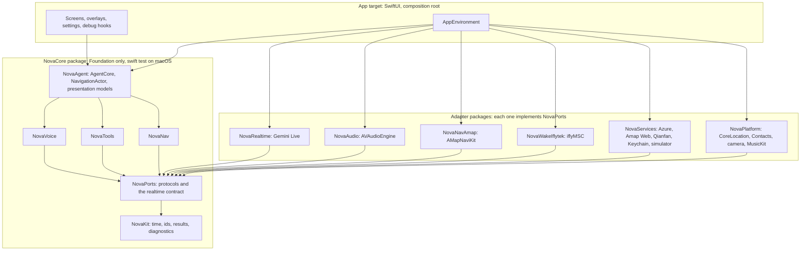
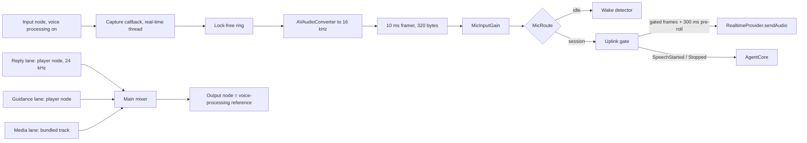
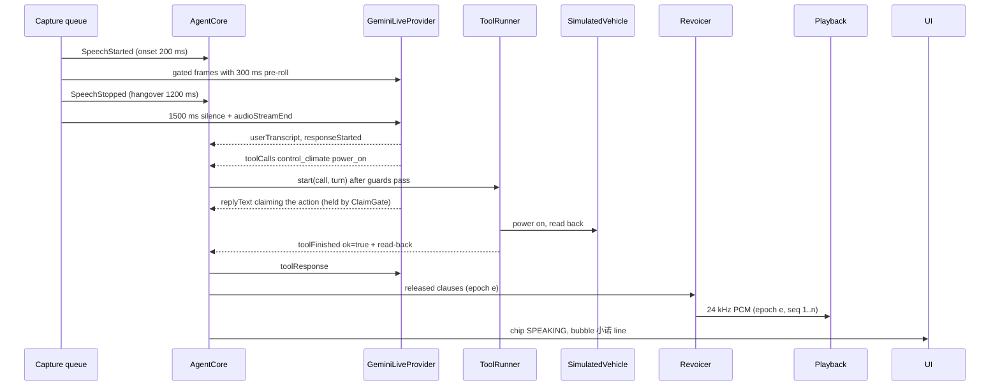
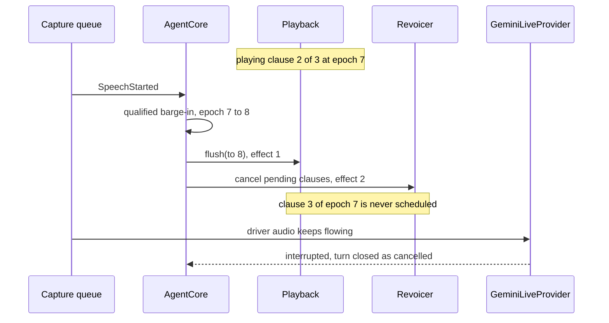
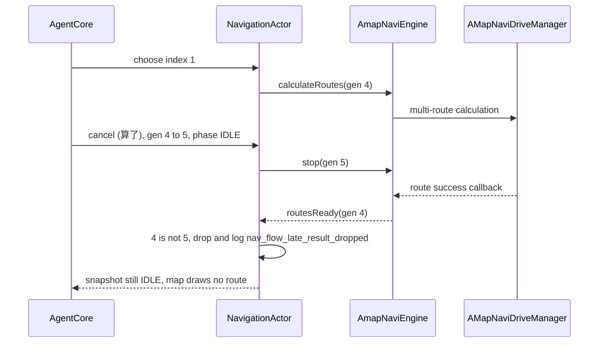

# iOS architecture design (v1, 2026-10-23)

The target architecture for the native iOS port of 小诺. It is based only on this `specs/` folder
(SPEC_VERSION `dfab878`). It turns the Android component list in [architecture.md](architecture.md)
and the package sketch in [migration-plan.md](migration-plan.md) into packages, ports, execution
domains and data flows that an Executor can build against.

Labels follow [README.md](README.md). **VERIFIED** points to the OQ row that cites the vendor source.
Everything else here is **PROPOSED** unless it is marked **DEVICE_SPIKE** or **OWNER**. No iOS code
has been built, and nothing in this file has run on an iPhone.

## 1. Design drivers

| Driver | Source | Consequence in this design |
|---|---|---|
| A claim waits for `ok=true`; audio and subtitle are held together | I-1, I-5, I-14 | Reply audio and text reach the speaker only through the claim gate inside `AgentCore` (§7) |
| Code enforces rules, not the prompt | I-11 | Guards, gates and the arbiter are deterministic Swift in `NovaCore`, unit-tested on macOS |
| App logic is provider-neutral | I-13 | `RealtimeProvider` port in `NovaPorts`; Gemini types never leave `NovaRealtime` |
| Vendor SDK isolation | I-9 (migration-plan) | Each SDK is imported by exactly one adapter package; an `imports` gate checks this (§13) |
| The arbiter alone decides who speaks | I-10 (F-08) | The arbiter runs in the same serial domain as the session and the reply pipeline |
| The UI never executes actions | I-6 | A tap becomes a `UIIntent` that enters the same dispatcher as a model tool call |
| No secrets or PII in source, logs or the bundle | I-7, I-8, F-22 | Every key lives in the Keychain (the Amap SDK key too); diagnostics are typed and carry no free text |
| Interruption is instant | contracts/audio.md, F-07 | Playback epochs plus a node flush; a 300 ms barge-in budget (§6.5) |
| Only one capture stream | ADR-006, contracts/audio.md rule 4 | One `AVAudioEngine`; a mic router hands frames to the wake detector or the uplink |
| The echo reference is exactly what was played | contracts/audio.md rule 1, OQ-IOS-3 | All app audio (reply, guidance, bundled music) plays through the voice-processing engine |
| Stale results never act | contracts/navigation.md, W3, W8 | Strong `Generation`, `Epoch` and `TurnID` types are checked at every boundary |
| Fast, deterministic iteration | migration-plan (NovaCore on macOS) | Functional core (synchronous state machines, time passed in) inside an imperative shell |
| Background services only for their intended use | OQ-IOS-4, Guideline 2.5.4 | A pure `BackgroundPolicy` decides mic, socket and location per state (§11.3) |

## 2. Architecture at a glance

The design is ports and adapters (hexagonal). A pure core owns every product rule. Adapters for
Apple frameworks and vendor services surround it, and the app target assembles the two.



Rules:
1. **Dependencies point inward.** An adapter imports only `NovaPorts` and `NovaKit`. No adapter
   imports another adapter. `NovaCore` imports only Foundation and Synchronization.
2. **Only the app target knows concrete adapter types.** `AppEnvironment` builds them and injects them as ports.
3. **One owner per framework** (§3.2). A second importer is a gate failure, not a review comment.

## 3. Packages and targets

### 3.1 Repository tree

```
NovaDriveIOS/
├── AGENTS.md                         # text from ai-agent-workflow.md
├── specs/                            # this folder, versioned by SPEC_VERSION
├── Packages/
│   ├── NovaCore/                     # Foundation only; swift test on macOS
│   │   ├── Sources/
│   │   │   ├── NovaKit/              # NovaInstant, Clock, Epoch, Generation, TurnID, CallID, JSONValue,
│   │   │   │                         #   ToolResult, error codes, DiagnosticEvent, *Tuning structs
│   │   │   ├── NovaPorts/            # adapter protocols (§4) + provider-neutral RealtimeEvent contract
│   │   │   ├── NovaVoice/            # F-02, F-04, F-05 core, F-06, F-07 logic, F-08, F-14 relay, F-24,
│   │   │   │                         #   F-01 arming, mic gain, 10 ms framer
│   │   │   ├── NovaTools/            # F-09 catalog/guards/dispatch, F-10, F-11 handlers, F-12, F-13,
│   │   │   │                         #   F-18..F-21 domains, system-instruction builder
│   │   │   ├── NovaNav/              # F-15 phase machine, choices, picker intercept, F-16 queries,
│   │   │   │                         #   saved places, corridor, WGS-84→GCJ-02, F-17 panel + overspeed
│   │   │   └── NovaAgent/            # AgentCore actor, NavigationActor, EffectRunner, BackgroundPolicy,
│   │   │                             #   SettingsReadiness, F-25 presentation models
│   │   └── Tests/                    # one Swift Testing target per source target + PCM corpus
│   ├── NovaRealtime/                 # Gemini codec, turn assembler, error classifier, URLSession transport;
│   │                                 #   Tests: fixtures/gemini/*.jsonl replay + local fake WebSocket server
│   ├── NovaAudio/                    # AVAudioSession policy, engine with voice processing, capture,
│   │                                 #   resampler, playback lanes, epoch flush, fallback guidance voice
│   ├── NovaNavAmap/                  # the only importer of AMapNaviKit; engine adapter + SwiftUI map view
│   ├── NovaWakeIflytek/              # the only importer of iflyMSC (M5)
│   ├── NovaServices/                 # Azure TTS, Amap Web REST, Qianfan, Keychain, UserDefaults,
│   │                                 #   SimulatedVehicle; Tests: fixtures/amap/*.json via URLProtocol stubs
│   └── NovaPlatform/                 # CoreLocation, Contacts, tel:// dialer, AVCapture still frames, MusicKit (M6)
├── App/
│   ├── NovaDriveApp.swift            # @main; scene phase → AgentCore
│   ├── AppEnvironment.swift          # composition root: builds adapters, wires streams
│   ├── Screens/                      # MainScreen (map + HUD), AssistantOverlay, StatusChip, ChoiceOverlay
│   ├── Settings/                     # developer settings cards (F-22)
│   ├── Lifecycle/                    # PermissionCoordinator, ScenePhaseBridge
│   ├── CarPlay/                      # M7 only: template scene reading the same snapshots
│   ├── Debug/                        # #if DEBUG: launch arguments + novadrive-debug:// URL scheme
│   └── Resources/                    # zh-Hans/en usage strings, bundled track, ivw/<APPID>.jet
└── UITests/                          # XCUITest on the simulator + device scripts for W1–W8
```

### 3.2 Framework ownership (checked by the `imports` gate)

| Framework | The only package allowed to import it |
|---|---|
| `AMapNaviKit`, `AMapFoundationKit`, `MAMapKit` | NovaNavAmap |
| `iflyMSC` | NovaWakeIflytek |
| `AVFAudio` (engine, session, player nodes, `AVSpeechSynthesizer`) | NovaAudio |
| `AVFoundation` capture (`AVCaptureSession`), `CoreLocation`, `Contacts`, `MusicKit` | NovaPlatform |
| `Security` (Keychain) | NovaServices |
| `UIKit`, `SwiftUI` | App, and NovaNavAmap (it wraps the UIKit map view) |
| `URLSessionWebSocketTask` | NovaRealtime (plain HTTP `URLSession` is allowed in NovaServices) |

Vendor binaries (Amap xcframeworks, the app-id-bound `iflyMSC.framework`) are wrapped as SwiftPM
`binaryTarget`s inside their adapter. If Amap ships only CocoaPods, the adapter can be an Xcode
framework target instead (confirm in M0). The iFlytek framework is downloaded for the owner's app id
(OQ-IOS-1, OWNER).

### 3.3 NovaCore target order

`NovaKit` ← `NovaPorts` ← {`NovaVoice`, `NovaTools`, `NovaNav`} ← `NovaAgent`. The three middle
targets do not import each other. Cross-cutting values (the navigation snapshot, tool results,
transcripts) are `NovaKit` types, so for example `NovaTools` guards can test "is navigating" without
importing `NovaNav`. Each target maps to a set of features (§14), so a task packet's OWNED_PATHS is
usually one target plus its tests.

## 4. Ports (`NovaPorts`)

| Port | Purpose | Production adapter | Test double |
|---|---|---|---|
| `RealtimeProvider` | Connect, stream audio, send tool responses and text, emit `RealtimeEvent` | `GeminiLiveProvider` (NovaRealtime) | `ScriptedRealtimeProvider` |
| `RealtimeCredentialSource` | API key now, ephemeral token later (OQ-IOS-5) | `KeychainApiKeySource`; later `EphemeralTokenSource` (OWNER backend) | in-memory |
| `CaptureSource` | 10 ms 16 kHz PCM16 frames, already echo-cancelled | `EngineCapture` (NovaAudio) | `PCMCorpusSource` |
| `PlaybackPort` | Reply lane, guidance lane, media lane, epochs, playback events | `EnginePlayback` (NovaAudio) | `RecordingPlayback` |
| `AudioSessionEvents` | Interruptions, route changes, media-services reset | `AudioSessionMonitor` (NovaAudio) | scripted |
| `SpeechSynthesizer` | Clause → 24 kHz PCM (Azure) | `AzureSpeechClient` (NovaServices) | `FakeSynthesizer` (fixed latency) |
| `FallbackGuidanceVoice` | Speak a guidance sentence when the relay falls back | `SystemSpeechGuidanceVoice` (NovaAudio, §9.5) | recording |
| `WakeWordDetector` | Arm/disarm, take frames, emit wake | `IflytekWakeDetector` (NovaWakeIflytek) | scripted |
| `NaviEngine` | Route calculation, selection, start/stop, guidance and navigation info events | `AmapNaviEngine` (NovaNavAmap) | `ScriptedNaviEngine` |
| `PlaceSearch`, `WeatherService`, `ReverseGeocoder`, `StaticMapService` | Amap Web REST | `AmapWebClient` (NovaServices) | fixture-backed |
| `LocationProvider` | Latest fix (WGS-84, accuracy, timestamp) | `CoreLocationProvider` (NovaPlatform) | fixed fixes |
| `VehicleControl` | Climate, seat, window state and changes | `SimulatedVehicle` (NovaServices) | the same simulator with fault injection |
| `MusicPort` / `NamedMusicPort` | Bundled play/stop; Apple Music search and now-playing check | media lane (NovaAudio); `MusicKitPlayer` (NovaPlatform, M6) | recording |
| `ContactsDirectory`, `PhoneDialer` | Contact lookup; open `tel://` | NovaPlatform | in-memory |
| `CameraFrameSource`, `VisionPort` | JPEG still; Qianfan question | NovaPlatform; `QianfanVisionClient` (NovaServices) | fixtures |
| `SettingsStore`, `CredentialStore` | UserDefaults; Keychain | NovaServices | in-memory |
| `Clock` | Monotonic `NovaInstant` and sleep-until | `ContinuousClock`-backed | `ManualClock` |
| `DiagnosticsSink` | Typed diagnostic events | `os.Logger` sink | recording |

Interface sketches (the shape only, not final code):

```swift
public enum RealtimeEvent: Sendable {             // provider-neutral names, contracts/voice-agent.md §4
  case setupComplete
  case userTranscript(String, final: Bool)
  case responseStarted(TurnID)
  case replyText(TurnID, String)                  // output transcription
  case replyAudio(TurnID, PCM24k)                 // dropped inside the adapter while revoicing
  case toolCalls(TurnID, [ToolCall])
  case toolCallCancellation([CallID])
  case audioDone(TurnID)                          // generationComplete
  case interrupted(TurnID, reason: InterruptReason)
  case responseDone(TurnID, outcome: TurnOutcome)
  case resumptionHandle(String?)
  case goAway(timeLeft: Duration?)
  case failed(RealtimeError)                      // kind: .retryable / .terminal, code (contracts §8)
}

public protocol RealtimeProvider: Sendable {
  var capabilities: RealtimeCapabilities { get }  // serverSpeechEvents=false, clientCancel=false for Gemini
  var events: AsyncStream<RealtimeEvent> { get }
  func connect(_ config: SessionConfig, resume handle: String?) async
  nonisolated func sendAudio(_ frame: PCMFrame16k) // data plane: non-blocking enqueue
  func sendAudioStreamEnd() async
  func sendToolResponses(_ results: [ToolResponse]) async
  func sendText(_ turns: [TextTurn], turnComplete: Bool) async
  func close() async
}

public protocol NaviEngine: Sendable {
  var events: AsyncStream<NaviEngineEvent> { get } // each event carries the Generation it answers
  func calculateRoutes(_ request: RouteRequest, generation: Generation) async
  func selectRoute(_ id: RouteID, generation: Generation) async
  func start(_ mode: NaviMode, generation: Generation) async   // .gps or .emulator
  func stop(generation: Generation) async
}

public protocol PlaybackPort: Sendable {
  func flush(to epoch: Epoch)                     // synchronous: stop the reply node, raise the epoch
  func enqueueReply(_ pcm: PCM24k, epoch: Epoch, seq: Int)
  func completeReply(epoch: Epoch)
  func playGuidance(_ pcm: PCM, id: GuidanceID)
  var events: AsyncStream<PlaybackEvent> { get }  // replyStarted/Finished(epoch), guidanceStarted/Ended
  var guidanceSounding: Bool { get }              // lock-protected; read synchronously by the Amap delegate
}
```

## 5. Runtime model

### 5.1 Execution domains

Android serialises session events under one mutex and uses separate threads for the socket reader,
capture and playback, plus a navigation lock with generation counters. The iOS mapping:

| Domain | Executor | Owns | Rules |
|---|---|---|---|
| Real-time audio | Core Audio I/O thread | capture callback only | No locks, no allocation, no Swift concurrency; copy samples into a lock-free single-producer ring |
| Capture processing | serial `DispatchQueue` (user-interactive) | resampler, 10 ms framer, gain, uplink gate, mic router | Synchronous per frame; reads `UplinkPolicy` from a `Mutex`; sends frames straight to the provider (data plane) |
| **AgentCore** | `actor` | session state machine, listening lifecycle, turn/reply pipeline, truthfulness guards, arbiter, guidance relay, driver context, dispatch decisions, navigation mirror | The single serialisation point (Android's mutex). Transitions are synchronous; I/O happens in effects after the transition |
| NavigationActor | `actor` | navigation phase machine, generation counter, pending choices | SDK calls go through the adapter; results come back tagged with a generation and stale ones are dropped |
| Provider | `GeminiLiveProvider` (`actor`) | socket, codec, turn assembler | Emits `RealtimeEvent` into a stream bounded at 1024, as on Android; overflow is counted as a bug signal |
| Revoicer | `actor` | clause queue, ≤2 Azure requests in flight, ordering, warm-up timer | Drops any synthesis result whose epoch is not current |
| Playback | serial `DispatchQueue` | the three `AVAudioPlayerNode` lanes, current epoch | Checks the epoch before scheduling a buffer; a flush stops the reply node and raises the epoch |
| Tool execution | child `Task`s owned by `ToolRunner` | one call each | Cancellable; always ends in a `ToolResult`, never throws into the session |
| UI | `@MainActor` | `@Observable` view models, Amap views | Consumes snapshots; emits `UIIntent`; holds no product state |

Swift 6 language mode with strict concurrency is used throughout. Every event, effect and snapshot
type is a `Sendable` value. Minimum iOS version: iOS 18 is proposed for `Observation` and
`Synchronization.Mutex` (OWNER, OQ-IOS-12).

### 5.2 Control plane and data plane

- **Data plane** (about 100 messages/s): uplink audio goes capture queue → `RealtimeProvider.sendAudio`.
  Revoiced reply audio goes Azure → Revoicer → `PlaybackPort`. Neither passes through `AgentCore`.
- **Control plane**: gate events, realtime events, tool results, playback and audio-session events,
  timers, UI intents and navigation snapshots all enter `AgentCore.send(_:)`, its only entry point.
- One exception, required by I-5: **without** revoicing, Gemini's own reply audio crosses the
  control plane so that the claim gate can hold it together with the subtitle (hold budget 120 events).
- `AgentCore` steers the data plane by publishing small policy values: `UplinkPolicy` (open, closed by
  guidance, closed by lifecycle) and `MicRoute` (wake or uplink). These are `Mutex`-protected values
  that the capture queue reads once per frame.

### 5.3 Functional core, imperative shell

Each ported Android component becomes a synchronous Swift type that is confined to its owning actor.
It has no threads, timers or I/O of its own. It takes the time as an argument and returns effects. It
keeps the Android method names where practical, so EVIDENCE_REQUEST answers map one to one.

```swift
// Shape of every NovaCore state machine (sketch).
struct ListeningLifecycle {                                   // A/voice/ListeningLifecycle.kt
  private(set) var state: ListeningState = .deepIdle
  mutating func handle(_ e: LifecycleInput, at now: NovaInstant) -> [LifecycleEffect]
}

actor AgentCore {
  func send(_ event: AgentEvent) {                            // the only entry point
    let effects = state.handle(event, at: clock.now)          // pure, synchronous, composed
    effectRunner.run(effects)                                 // in order: flush before notify, etc.
  }
}
```

`AgentEvent` covers `realtime`, `gate`, `wake`, `uiIntent`, `toolFinished`, `navigation(snapshot)`,
`guidancePrompt`, `playback`, `audioSession`, `timer`, `scene` and `settingsChanged`. `AgentEffect`
covers `provider(command)`, `flushPlayback(epoch)`, `speak(clause)`, `setUplink(policy)`,
`setMicRoute`, `startTool`, `cancelTool`, `navigation(command)`, `schedule(timer, at)`,
`cancelTimer`, `publish(viewState)` and `diagnostic`. The runner executes effects in the order they
were returned, which is how contract orderings such as "flush playback first, then notify the
provider" are kept.

### 5.4 Identity types

| Type | Increments on | Checked by |
|---|---|---|
| `Epoch` | barge-in, cancel, `闭嘴`, reply voided | Revoicer and Playback (stale audio is discarded) |
| `Generation` | every navigation request or cancel | NavigationActor (stale SDK callbacks are dropped: `nav_flow_late_result_dropped`) |
| `TurnID` | each provider turn | ToolRunner and the reply pipeline (a late call from an abandoned turn is dropped, W3) |
| `CallID` | from the provider (≤128 chars, `[A-Za-z0-9_-]`) | dispatcher (duplicates, cancellation) |
| `TimerID` + epoch | each scheduling | AgentCore (a timer from an older epoch is ignored, as in the Android lifecycle) |

Each is a distinct struct, so an epoch cannot be passed where a generation is expected.

### 5.5 Time and tuning

- `NovaInstant` is a monotonic millisecond count (the Android constants are milliseconds). Production
  uses `ContinuousClock`; tests use `ManualClock` and advance it explicitly. Timers are effects, and
  the shell's `TimerService` turns them into `.timer` events.
- Every spec constant (gate onset 200 ms, hangover 1200 ms, lifecycle 30 s / 20 s / 5 min, wait cues
  3/7/12/60 s, reconnect 200 ms ×2 up to 8 s, relay 1200 ms deadline, and so on) lives in a per-feature
  `*Tuning` struct. Its defaults equal the Android values and each field cites its spec line. Debug
  builds can override the values for iOS re-tuning (F-04 §13), and release builds cannot.

## 6. Audio architecture

### 6.1 Engine graph



### 6.2 Audio session policy

- Category `.playAndRecord`, mode `.voiceChat`, options `.defaultToSpeaker` and `.allowBluetooth`
  (ios-feasibility). Ducking other apps with `.duckOthers`, either for the whole session or only while
  she speaks, is decided by `AudioSessionPolicy` from the lifecycle state. Which granularity sounds
  right in a car is DEVICE_SPIKE (M0).
- The session is active only while `BackgroundPolicy` (§11.3) says the mic or speech is needed. It is
  deactivated in DEEP_IDLE, with `.notifyOthersOnDeactivation`.
- Preferred I/O buffer duration is 10 ms, to keep capture latency inside the barge-in budget (§6.5).

### 6.3 Capture chain

The order follows contracts/audio.md rule 2: **echo cancellation (voice processing) → gain → gate**.
Apple voice processing includes its own AGC, so it can stack with `MicInputGain`. M0 measures three
configurations (VP AGC on and our gain off, VP AGC off and our gain on, both on) on the speech-harness
clips and keeps one; both switches stay configurable (DEVICE_SPIKE, OQ-IOS-3). Low-latency capture
uses an `AVAudioSinkNode` on the input. If that does not work with voice processing enabled, the
fallback is `installTap` with the smallest buffer the device grants (DEVICE_SPIKE, OQ-IOS-14).
Exactly 10 ms, 16 kHz frames are unit-tested on the resampler and framer (F-03 §10).

### 6.4 Playback lanes and epochs

- **Reply lane**: 24 kHz PCM from Azure (or from Gemini when not revoicing). Clauses are scheduled
  in sequence order. `flush(to:)` calls `stop()` on the reply node, which drops the scheduled buffers,
  then `play()` again and raises the epoch. Late Azure results for the old epoch are discarded before
  they are scheduled (W2, F-07 §10).
- **Guidance lane**: relayed or fallback guidance sentences (F-14). A guidance-sounding flag,
  protected by a lock, is set from first buffer to completion. `driveManagerIsNaviSoundPlaying:`
  reads it (§9.5) and so does the arbiter (R1).
- **Media lane**: the bundled track (F-13). It plays through the engine so that voice processing has
  it in the echo reference and music does not cause self barge-in. This replaces the separate
  `AVAudioPlayer` named in ios-feasibility.md (§16). Apple Music through MusicKit plays outside the
  engine, so its echo behaviour is DEVICE_SPIKE (OQ-IOS-11).
- Media-services reset: rebuild the graph, raise the epoch, and report `audioSession(.reset)` to
  `AgentCore`, which treats it as R4 (DROP).

### 6.5 Barge-in latency budget (F-08 target ≤300 ms, UNVERIFIED baseline)

| Step | Budget | Owner |
|---|---|---|
| Capture callback + ring + resample | ≤20 ms | NovaAudio (10 ms I/O buffer) |
| Gate onset | 200 ms (spec constant) | NovaVoice |
| Hop to AgentCore + qualification decision | ≤5 ms | NovaAgent |
| `flush`: node stop | ≤10 ms | NovaAudio |
| Output latency of the route | ≈10–40 ms (speaker vs Bluetooth) | hardware |
| **Total** | **≈245–275 ms** | measured in M1 on device |

The onset constant dominates. A tap buffer of about 100 ms would break the budget, which is why
§6.3 asks for low-latency capture.

### 6.6 iOS interruptions → arbiter inputs (contracts/voice-agent.md §5)

| iOS signal | Arbiter input | Behaviour |
|---|---|---|
| `interruptionNotification` began | R5 transient loss | Hold the unstarted reply; capture stops (the system does this) |
| Interruption ended with `.shouldResume` | focus regained | Reactivate the session, restart the engine, release holds |
| Interruption ended without `.shouldResume` | R4 permanent loss | Drop the pending reply; stay idle until the driver or the wake word |
| `routeChangeNotification` with `oldDeviceUnavailable` | R5 | Hold, then re-evaluate on the new route |
| `mediaServicesWereResetNotification` | R4 | Drop; rebuild the engine (§6.4) |

### 6.7 If voice processing is not good enough (OQ-IOS-3 fails)

Port WebRTC AEC3 as C++ inside NovaAudio behind the same `CaptureSource` port. The render reference
is tapped from the main mixer right before output, as Android feeds it before the hardware write.
Port the delay estimator as well, and run the input node with voice processing off. Nothing outside
NovaAudio changes.

## 7. Voice session and reply pipeline

### 7.1 Components inside AgentCore (ported from Android, class A)

| Component | Port of | Job |
|---|---|---|
| `VoiceSession` | `VoiceSessionController`, `VoiceSessionStateMachine` | UI states §1, connect, `setupComplete` deadline 10 s, resumption handle kept in memory |
| `ReconnectPolicy` | `I/ReconnectPolicy.kt` | 5 attempts, 200 ms doubling, 8 s cap; a second error from the same socket joins the reconnect in flight |
| `ListeningLifecycle`, `ListeningIntent` | F-02 | ACTIVE / SILENT_WAIT / SLEEP / DEEP_IDLE; whole-utterance local phrases |
| `DriverTurnPipeline` + `ClaimGate` | F-06 | Holds claim audio and text until the matching `ok=true` result |
| `ActionClaimGuard`, `CorrectionGrace`, `EmptyResponseRetryPolicy`, `PhantomTurnGate` | F-06 | Corrections, the 6 s re-ask / 10 s give-up (W3), phantom suppression |
| `ClauseSegmenter`, `WaitCues` | F-07 | Judged `SpeechText` → clauses; 3/7/12 s cues |
| `SpeechArbiter`, `PlayoutBargeInQualification` | F-08 | PLAY/HOLD/DROP, uplink policy, barge-in |
| `GuidanceRelay`, `GuidanceFidelity` | F-14 | Assistant or fallback voice, with reason codes |
| `DriverContext`, `ContextResolver` | F-10 | Referents from ok results (180 s), Adjust or Clarify |

`SessionConfig` (persona + call-first hint ≤4000 chars, tool declarations, voice, `zh-CN`, VAD
settings) is assembled provider-neutrally in `NovaTools`. `NovaRealtime` encodes it as Gemini `setup`.

### 7.2 Gemini adapter internals (NovaRealtime)

| Part | Pure? | Job |
|---|---|---|
| `GeminiCodec` | yes | Encode `setup`, `realtimeInput.audio` (base64 16 kHz), `audioStreamEnd`, `clientContent`, `toolResponse`; decode server messages |
| `GeminiTurnAssembler` | yes | The six ordering rules of contracts/voice-agent.md §4; duplicate-call marking; reject calls during a guidance turn |
| `GeminiErrorClassifier` | yes | Close codes 1007 (clear handle, `RESUME_UNAVAILABLE`) and 1008; retryable vs terminal |
| `GeminiTransport` | no | `URLSessionWebSocketTask`, connect timeout 10 s, ping every 20 s |
| `GeminiLiveProvider` | no | Implements `RealtimeProvider`; drops Gemini audio while revoicing |

The pure parts are tested on macOS by replaying `fixtures/gemini/*.jsonl` (the contract gate). The
whole provider is integration-tested against a local fake WebSocket server (W4, F-24).

### 7.3 W1: normal turn, claim held until the tool succeeds



### 7.4 W2: barge-in



An unqualified SpeechStarted during playback is logged as residual echo and changes nothing.

## 8. Tools

Pipeline for every call, whether from the model, a local pick, or a UI tap (I-6):

1. **Validate** (NovaTools, synchronous): name in catalog, args ≤4096 bytes, schema. Failure →
   `_validation_error`.
2. **Guards** in Android order, first refusal wins: unsupportedMedia → sunroofOnWindowTool →
   nearbyQuestionWhileNavigating → vagueExitWhileNavigating → speechOutputNotRequested →
   ambiguousReferent → repeatedInTurn. Rewrites and checks follow: driverSideWindow, savedPlaceMissing,
   withPowerAdvice. Guards read the transcript, `DriverContext` and the navigation mirror, all inside
   AgentCore, so the result is deterministic.
3. **Execute**: AgentCore emits `startTool`, and `ToolRunner` runs the executor in a child `Task`
   (dispatcher waits: navigation request 10 s, options 8 s; live info timeout 4 s). A thrown error
   or a timeout becomes `ok=false` with a code. `toolCallCancellation` cancels the task. A result
   whose `TurnID` was abandoned is dropped.
4. **Result**: `toolFinished` enters AgentCore. The claim gate settles, `DriverContext` records the
   referents (ok results only), and the response with `ToolFailureAdvice` wording goes to the provider.
   Each executed action is announced from its read-back (I-14).

The catalog keeps Android tool names and JSON schemas byte-for-byte, so the same system prompt works
(F-09 iOS notes). In M1 the whole catalog is declared, but only `control_climate`, `control_seat`
and `control_window` have executors. Every other tool gets a `NotYetExecutor` that returns one
deterministic error code (name PROPOSED: `NOT_AVAILABLE_ON_IOS_YET`) with one honest sentence (I-2).

## 9. Navigation

### 9.1 Ownership

`NavigationActor` hosts the pure `NavigationController` (phases and rules of contracts/navigation.md),
the generation counter, the pending choice list with its 120 s expiry, and the local-pick duplicate
suppression window (5 s). After every change it publishes a `NavigationSnapshot` (phase, generation,
list kind, guidance kept, distance to manoeuvre, remaining distance and time) to AgentCore (for guards,
the 「导航已开始」 claim check, lifecycle and arbiter R6/R6a) and to the UI. Nobody reads navigation
state synchronously across actors.

### 9.2 Amap adapter (NovaNavAmap)

- `AmapNaviEngine` wraps `AMapNaviDriveManager`. Each call records the generation it was issued under,
  and each delegate callback (route success or failure, `updateNaviInfo:`, `updateCameraInfos:`,
  `playNaviSoundString:soundStringType:`, arrival) is wrapped as a `NaviEngineEvent` carrying that
  generation (VERIFIED API names, OQ-IOS-2; the route-select call is confirmed in M3). The adapter
  makes no assumption about the callback thread.
- `AmapMapView` is a SwiftUI `UIViewRepresentable` around the drive view or map view. What it draws
  comes from the pure `MapPresentationPolicy` in NovaNav, so after 算了 no route line remains (P59,
  F-15 §10).
- The SDK key is entered in developer settings and read from the Keychain before the drive manager is
  created, rather than kept in Info.plist (I-7, §16). Amap's privacy-compliance calls (privacy shown,
  privacy agreed) are expected before first use; confirm the exact API in the M0 hello-route.

### 9.3 W8: cancel while a route is calculating



### 9.4 Search, location, saved places (F-16)

`CoreLocationProvider` provides WGS-84 fixes (when-in-use; `allowsBackgroundLocationUpdates` only
while guidance runs, OQ-IOS-4). NovaNav converts them to GCJ-02 in pure Swift, cross-checked against
the Amap SDK conversion in M3. Saved places are stored already in GCJ-02 and are not converted again.
Query normalisation, keyword stripping, 家/公司 detection (家乐福 is not 家) and the along-route
corridor (500 m half-width, 50 m simplification, ≤64 vertices) are pure and table-tested.
Recentering uses the spec thresholds (fresh 30 s, provisional 10 min, accuracy ≤2000 m).

### 9.5 Guidance relay and arbitration (F-14, F-08, W5)

- Amap's built-in TTS is off by default on iOS (VERIFIED, OQ-IOS-2). Every sentence arrives in
  `playNaviSoundString:` and becomes a `GuidancePrompt` for AgentCore. The relay sends it to the model
  verbatim (「请一字不改地朗读…」) or falls back with a reason code (DEADLINE 1200 ms, COOLDOWN 60 s
  after 2 consecutive deadline fallbacks, FIDELITY_STRIKES ≥2, NOT_CONNECTED, and so on).
- **Fallback voice on iOS.** Android falls back to Amap's own voice. On iOS the proposed fallback is
  `AVSpeechSynthesizer` (zh-CN) rendered to buffers and played on the guidance lane, so it is offline,
  inside the echo reference, and visible to the arbiter. The alternative is to switch on Amap's
  internal TTS for the remaining trip. Decide in M4 (OQ-IOS-10).
- `driveManagerIsNaviSoundPlaying:` must return a Bool synchronously, so it reads the playback's
  lock-protected guidance-sounding flag (§6.4). It never waits on an actor.
- While guidance sounds, the arbiter applies R1 (hold the reply) and closes the uplink until 500 ms
  after guidance ends (reopening after at most 20 s; R0 keeps an open utterance up to 8 s). R6a holds
  an unstarted reply within 150 m of a manoeuvre for up to 8 s.

### 9.6 HUD and overspeed (F-17)

`TextNavigationPanelModel` and `OverspeedAlert` are pure functions of navigation info and camera info,
tested against fixtures. Remaining time comes from `updateNaviInfo:`. It is shown on the HUD and can
later feed a new ETA field in `route_traffic` (OQ-AND-3: Android has no such field, so this is not parity).

## 10. Persistence, secrets and privacy

| Data | Store | Notes |
|---|---|---|
| Model, voice, consent, speaking style, saved places, guidance flags | UserDefaults via `SettingsStore` | Style persists across sessions (F-21) |
| Gemini key, Azure key, Amap SDK key, Amap Web key, iFlytek app id, Qianfan key | Keychain via `CredentialStore`, `kSecAttrAccessibleAfterFirstUnlock` | Write-only in the UI: never shown after save, a blank field keeps the stored value (F-22) |
| Conversation, resumption handle | memory only | Cleared on disconnect |

- `CredentialWipe` holds the one list of keys that 清除所有密钥 removes. A unit test asserts the list
  equals every key `CredentialStore` has ever written.
- **Typed diagnostics (I-7, I-8).** `DiagnosticEvent` is an enum whose payloads are only codes,
  counts, durations and enums, never `String`, so a transcript, address, coordinate or key cannot be
  logged by construction. A lint rule bans `print`, `NSLog` and direct `Logger` use outside the
  diagnostics sink.
- The `secrets` gate scans source, xcconfig and Info.plist for key patterns (ai-agent-workflow.md).

## 11. App shell

### 11.1 UI (F-25)

`MainScreen` is a `ZStack`: the Amap map view, the HUD panel, the assistant bubble (latest exchange
only, fades by itself), the status chip and the choice overlay. View models are `@Observable` on the
main actor and fed by snapshot streams from AgentCore and NavigationActor. The chip mapping, bubble
fade and choice list models are pure in `NovaAgent` and unit-tested against the Android constants. A
tap sends `UIIntent.choose(index)`, which enters the dispatcher with source `.ui` (I-6).

### 11.2 Settings and permissions (F-22, F-23)

Developer settings are a SwiftUI `Form` with the Android cards (status, Gemini consent/key/model,
persona, Azure, Amap, wake, vision, diagnostics, danger). `SettingsReadiness` (pure) produces the
config banner and blocks a session without consent (`GEMINI_CONSENT_MISSING`). `PermissionCoordinator`
asks for each permission on first need: microphone at the first talk, location at map start,
contacts at the first call, camera at the first vision question. It explains a denial. Usage strings
come in zh-Hans and English.

### 11.3 Background policy (OQ-IOS-4)

`BackgroundPolicy` is a pure function of (scene phase, listening state, navigation phase) that returns
which of the audio session, mic, socket and background location to keep:

| Scene | State | Mic | Socket | Background location |
|---|---|---|---|---|
| foreground | any | as the lifecycle says | as the lifecycle says | — |
| background | navigating (any listening state) | yes, mic indicator visible | yes | yes |
| background | ACTIVE / SILENT_WAIT, not navigating | yes, until the turn completes and the lifecycle sleeps | yes | no |
| background | SLEEP, not navigating | **no**: go to DEEP_IDLE at once (OWNER, OQ-IOS-13) | closed | no |
| background | DEEP_IDLE | no; deactivate the session so the app suspends | closed | no |

The wake word is therefore in-app only (OQ-IOS-1): it works in the foreground and while a
background session is legitimately active. Review notes describe this policy.

### 11.4 Debug hooks (replacing the Android broadcast receiver)

These exist only under `#if DEBUG`: launch arguments (`-NovaDebug.*`) and a `novadrive-debug://` URL
scheme. Commands cover simulated wake, injected transcript, forced socket drop
(`NetworkFaults.dropConnectionNow`), emulator navigation and fixture selection. Every command enters
AgentCore as an ordinary event and never bypasses the dispatcher.

### 11.5 CarPlay seam (M7)

A `CPTemplateApplicationScene` in the App target reads the same snapshots and sends the same
`UIIntent`s. It holds no logic. Only one category is possible (OQ-IOS-8). Navigation would reuse the
Amap CarPlay drive-view adaptation inside NovaNavAmap.

## 12. Error boundaries (iOS)

| Boundary | Behaviour |
|---|---|
| Provider | `RealtimeError` is classified in the adapter. Retryable → `ReconnectPolicy` with the handle, UI shows PROCESSING. Terminal (auth, credential, quota, malformed model) → ERROR plus a config banner, no retry |
| Tool | Every failure is a `ToolResult(ok: false, code:)` with `ToolFailureAdvice`. Nothing is thrown past `ToolRunner` |
| TTS | Azure failure: the subtitle still shows and Gemini audio is never substituted (F-07) |
| Navigation SDK | Calculation failure → ERROR phase with a code; late callbacks are dropped by generation |
| Capture | Engine start or read failure → `AUDIO_CAPTURE_FAILED`, capture stopped; on media-services reset, rebuild once and then report |
| Wake engine | Bounded retry (1.5 s base, 30 s max, 6 attempts) → wake unavailable; the talk button still works |
| Network path | Optional `NWPathMonitor` hint that skips the backoff once a path returns (improvement, not parity, F-24) |

## 13. Testing architecture and gates

| Level | Where | What |
|---|---|---|
| Unit | `swift test` on macOS: NovaCore, NovaRealtime pure parts, NovaServices | Ported Android test tables; `ManualClock`; PCM corpus for the gate; golden files for vehicle and scenarios |
| Contract | `swift test` | `fixtures/gemini/*.jsonl` → event order (§4); `fixtures/amap/*.json` → parsers and queries |
| Integration | `swift test` | AgentCore with `ScriptedRealtimeProvider`, `ScriptedNaviEngine`, `RecordingPlayback`, `FakeSynthesizer`: W1–W8 end to end without audio; fake WebSocket server for W4 |
| Simulator | `xcodebuild test` | Adapters that need iOS (NovaAudio wiring, NovaNavAmap), XCUITest for the choice overlay and the route not drawn after cancel |
| Device | opt-in, evidence attached | Echo (F-03), barge-in latency (§6.5), V-LAT, background policy, wake |

Gates, added to those in ai-agent-workflow.md:
- **imports**: the §3.2 ownership table, plus "NovaCore imports only Foundation/Synchronization".
- **spec-trace**: Swift Testing names carry the acceptance ID (for example
  `@Test("F-04 noise bed keeps gate closed")`, or `W8` for workflows), so every acceptance row in a
  task packet can be found by grep.

## 14. Feature → module map

| F | Logic (NovaCore target) | Adapter(s) | Runs in |
|---|---|---|---|
| F-01 Wake word | NovaVoice `WakeArming`, `WakeController` | NovaWakeIflytek | capture queue (frames), AgentCore (events) |
| F-02 Listening lifecycle | NovaVoice | — | AgentCore |
| F-03 Capture + AEC | NovaVoice `MicInputGain`, framer | NovaAudio | real-time thread → capture queue |
| F-04 Uplink gate | NovaVoice `SpeechUplinkGate` | — | capture queue |
| F-05 Realtime session | NovaVoice `VoiceSession` | NovaRealtime | AgentCore / provider actor |
| F-06 Truthfulness | NovaVoice pipeline and guards | — | AgentCore |
| F-07 TTS + playback | NovaVoice segmenter, wait cues | NovaServices Azure, NovaAudio reply lane | Revoicer, playback queue |
| F-08 Barge-in, arbitration | NovaVoice `SpeechArbiter` | NovaAudio session monitor | AgentCore |
| F-09 Tools + guards | NovaTools | — | AgentCore + ToolRunner |
| F-10 Ambiguity | NovaTools `ContextResolver` | — | AgentCore |
| F-11 Vehicle | NovaTools handlers | NovaServices `SimulatedVehicle` (`BACKEND_LABEL=simulated`) | ToolRunner |
| F-12 Scenarios | NovaTools `ComfortScenarios` | — | ToolRunner |
| F-13 Music | NovaTools media domain, now-playing check | NovaAudio media lane; NovaPlatform MusicKit (M6) | ToolRunner |
| F-14 Guidance relay | NovaVoice `GuidanceRelay` | NovaNavAmap text, NovaAudio guidance lane + fallback voice | AgentCore |
| F-15 Navigation flow | NovaNav controller, choices, intercept, presentation policy | NovaNavAmap | NavigationActor |
| F-16 Search, saved places | NovaNav queries, corridor, GCJ-02 | NovaServices Amap Web, NovaPlatform location | ToolRunner |
| F-17 HUD, overspeed | NovaNav panel model, overspeed | NovaNavAmap info events | NavigationActor → UI |
| F-18 Live info | NovaTools live-info domain and parser | NovaServices Amap Web | ToolRunner |
| F-19 Phone | NovaTools confirm window | NovaPlatform contacts, dialer | ToolRunner (+ main actor for `open`) |
| F-20 Vision | NovaTools vision domain | NovaPlatform camera, NovaServices Qianfan | ToolRunner |
| F-21 Persona, style | NovaTools persona profiles | NovaServices settings | AgentCore |
| F-22 Settings | NovaAgent `SettingsReadiness`, `CredentialWipe` | NovaServices stores; App settings UI | main actor |
| F-23 Lifecycle | NovaAgent `BackgroundPolicy` | App lifecycle, permissions | main actor → AgentCore |
| F-24 Network recovery | NovaVoice `ReconnectPolicy` | NovaRealtime classifier | AgentCore |
| F-25 UI | NovaAgent presentation models | App screens | main actor |

## 15. Build order by milestone (migration-plan.md)

| M | Modules that come alive |
|---|---|
| M0 | Spike app: NovaAudio (VP AEC, AGC choice, sink-node latency), NovaNavAmap hello-route (route select call, privacy API, key at runtime) |
| M1 | NovaKit, NovaPorts, NovaVoice (F-02, F-04, F-05, F-06, F-07, minimal F-08, F-24), NovaTools (F-09, F-11), NovaAgent, NovaRealtime, NovaAudio reply lane, NovaServices (Azure, Keychain, Defaults, SimulatedVehicle), App: tap-to-talk, chip, bubble, settings subset |
| M2 | NovaTools F-10, F-12, F-13 (bundled, media lane), F-18 weather, F-21 |
| M3 | NovaNav, NovaNavAmap, NovaPlatform location; F-15, F-16, F-17, choice overlay |
| M4 | Guidance lane, relay, fallback voice, arbiter R1/R6/R6a, overspeed voice |
| M5 | NovaWakeIflytek, mic router, `BackgroundPolicy` on device |
| M6 | NovaPlatform contacts, dialer, camera, MusicKit (if OQ-IOS-7 approves) |
| M7 | CarPlay scene (one category, OQ-IOS-8) |

## 16. Refinements to the existing spec

These change or sharpen statements elsewhere in `specs/`. Merge them into those files once accepted.

1. **The provider contract lives in `NovaCore/NovaPorts`, not in NovaRealtime** (migration-plan).
   This lets the core depend on nothing and Gemini depend on the core.
2. **Two new adapter packages**: `NovaWakeIflytek` and `NovaPlatform`, so iFlytek and the Apple
   device frameworks also have a single owner each.
3. **Tests live with their package** (SwiftPM resources must sit inside the package). The root keeps
   only `UITests/` and device scripts, instead of a root `Tests/` mirror.
4. **The Amap SDK key moves to the Keychain** (entered in settings) and out of Info.plist, to meet
   "no secrets in the app bundle" (F-22, I-7).
5. **Bundled music plays through the voice-processing engine** (media lane), not a separate
   `AVAudioPlayer` (ios-feasibility), so that it is in the echo reference.
6. **The guidance fallback voice** is `AVSpeechSynthesizer` on the guidance lane, pending OQ-IOS-10,
   because Amap's internal TTS is off by default on iOS.
7. **Backgrounded SLEEP without navigation drops to DEEP_IDLE at once**, which is stricter than
   Android's 5 min, for Guideline 2.5.4 (OWNER, OQ-IOS-13).

## 17. New open questions raised by this design

Statuses use the open-questions.md vocabulary. Copy them there once accepted.

| ID | Question | Needed for | Status |
|---|---|---|---|
| OQ-IOS-9 | Does `IFlyVoiceWakeuper` accept app-fed audio (external audio source plus a write-audio call)? If it can only record by itself, the one-capture rule forces the engine to stop while the wake word listens | M5 | DEVICE_SPIKE (check the iOS SDK reference first) |
| OQ-IOS-10 | Guidance fallback voice: `AVSpeechSynthesizer` on the guidance lane, or Amap internal TTS switched on for the rest of the trip? | M4 | DEVICE_SPIKE |
| OQ-IOS-11 | Does voice processing cancel audio played outside our engine (MusicKit), or does Apple Music cause self barge-in? | M6 | DEVICE_SPIKE |
| OQ-IOS-12 | Minimum iOS version (iOS 18 proposed; CarPlay voice-conversational would need 26.4) | M1 | OWNER |
| OQ-IOS-13 | Background SLEEP without navigation: drop to DEEP_IDLE at once (proposed), or keep Android's 5 min? | M5 | OWNER |
| OQ-IOS-14 | Capture latency with voice processing: does `AVAudioSinkNode` work, and what buffer does `installTap` actually deliver? | M0 | DEVICE_SPIKE |
| OQ-IOS-15 | Production Gemini auth: who hosts the ephemeral-token endpoint? Until then, the API key comes from the Keychain (dev only) | before release | OWNER |
